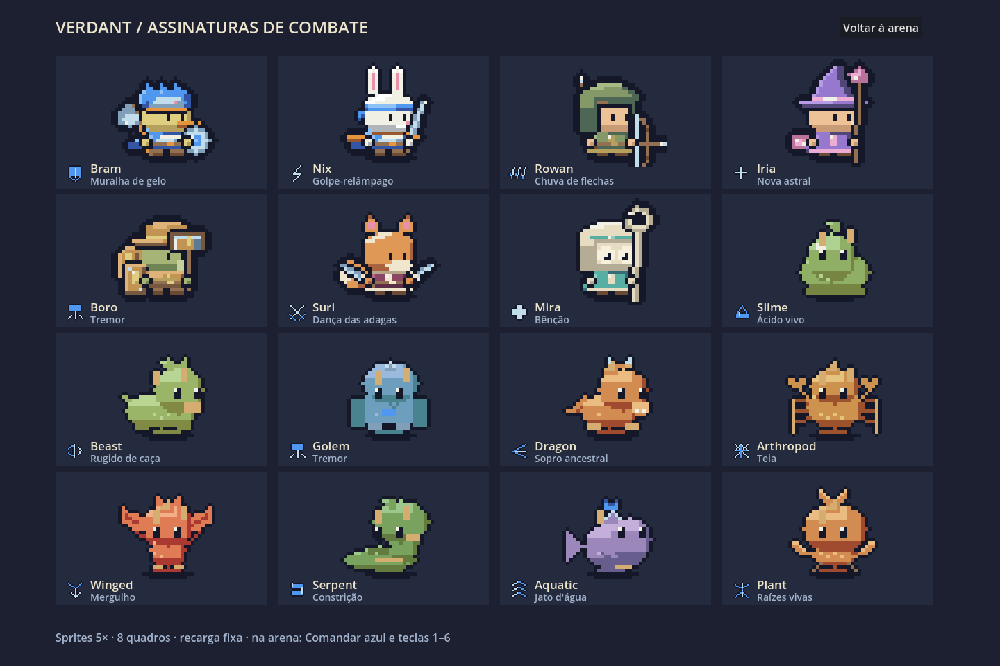
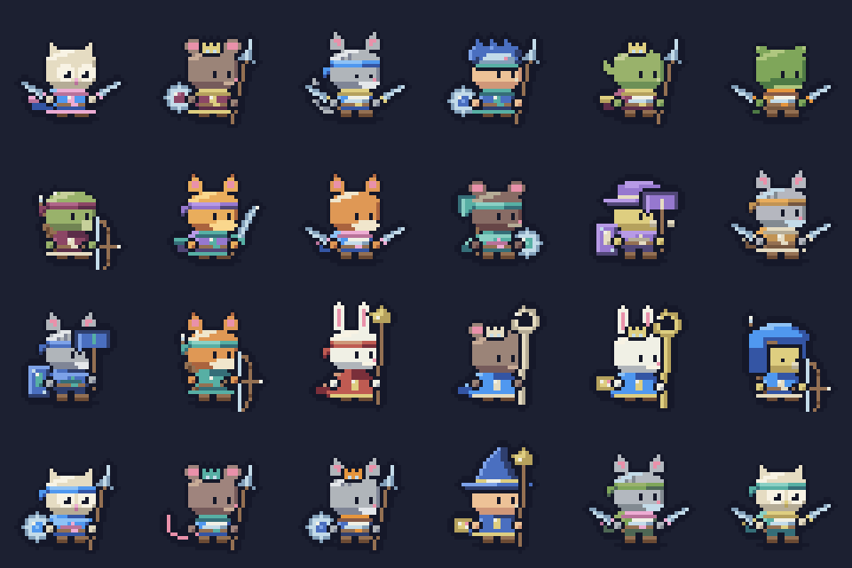
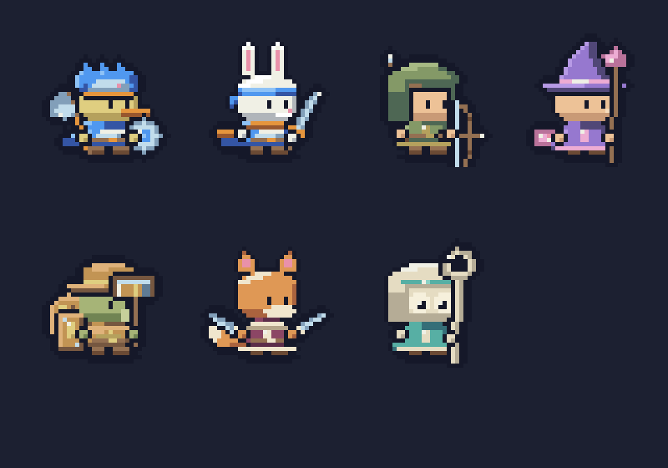
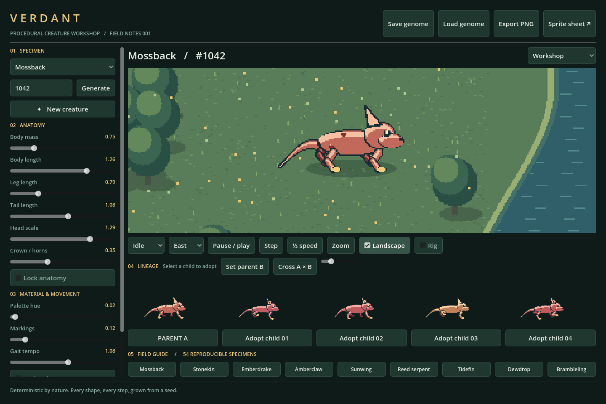

# VERDANT — roguelike dos reinos (fundação R0)


**Revisão visual do elenco:** os sete heróis agora usam poses em três quartos, corpos mais baixos e largos, roupas por classe, equipamentos redesenhados e uma equipe azul comum. A galeria oferece **Equipe azul / Cores do herói**, animações e comparação em 1×/2×/3×. [Prancha atual](docs/arte/revisao-referencia/elenco.png) · [Antes/depois](docs/arte/revisao-referencia/comparacao.png) · [Validações e limites](docs/arte/revisao-referencia/RELATORIO.md) · [Windows](https://github.com/Gui571/VERDANT/raw/refs/heads/revisao-visual-referencia/downloads/Verdant-Windows.zip) · [Linux](https://github.com/Gui571/VERDANT/raw/refs/heads/revisao-visual-referencia/downloads/Verdant-Linux.zip). Extraia tudo e abra `Verdant.exe` ou `Verdant.x86_64`. Build Linux executada; EXE Windows exportado e conferido por integridade, ainda não executado neste Linux.

**Nova direção:** runs com grupo de heróis e cinco reinos em ordem livre. O plano de economia nacional, extração e guerra territorial foi substituído. **Entrega atual: R0**, biblioteca sem Godot, auditoria, presets Android e prova web; a run começa a ser implementada em R1. [Visão e marcos](docs/ROGUELIKE.md) · [Reinos](docs/REINOS.md) · [Portabilidade e testes](docs/PORTABILIDADE.md).

O jogo disponível agora continua sendo a arena/oficina abaixo. Abra pelo Godot com `./scripts/run.sh`; para a prova de combate no navegador, siga [WebProof](tools/WebProof/README.md). Não há menu Nova run/Continuar nesta etapa. Os ZIPs abaixo são as builds anteriores de especiais, preservadas; builds finais do roguelike pertencem a R5. APK não gerado e Android não executado.

**Revisão de arte dos monstros:** nove famílias com anatomia e mortes próprias, detalhes elementais animados, chefes com segunda fase visual e prévia da oficina usando atlas. [Antes/depois e crítica visual](docs/ARTE-MONSTROS-AUDITORIA.md) · [Como editar e testar](docs/MONSTROS.md) · [Relatório](docs/arte/RELATORIO.md). Os downloads existentes abaixo ainda são as builds anteriores; execute pelo Godot para ver esta revisão.

**Terrenos generativos 2.5D:** abra **Terrenos 2.5D** no elenco/oficina/arena. Gere por semente, ajuste relevo/água/vegetação e use o mapa na arena. Base MIT [Cartoon Terrain Studio](https://github.com/idlerunner00/cartoon-terrain-studio), adaptada para Godot 4.5.2. [Guia, capturas e testes](docs/TERRENOS.md).

**Forge v2 — M0/M1:** auditoria e pipeline opcional de materiais/luz, cinco tons OKLCH e seis equipes. Abra **Materiais v2** no elenco/oficina; ative **Estilo v2** na arena. O padrão anterior continua preservado. [Antes/depois](docs/arte/estilo-v2/m1-antes-depois.png) · [Direção](docs/DIRECAO-ESTILO-V2.md) · [Relatório e limites](docs/arte/estilo-v2/RELATORIO-M1.md). [Windows atualizado M1](https://github.com/Gui571/VERDANT/raw/refs/heads/estilo-v2-m1-cor-luz/downloads/Verdant-Windows.zip): extraia tudo e abra `Verdant.exe`; exportado e verificado por integridade, EXE ainda não executado neste Linux. M2–M8 continuam pendentes.

```sh
dotnet build core/Verdant.Core.csproj
dotnet run --project tools/PixelPreview -- pixel-verify docs/portability/atlas-sha256.json
dotnet run --project tools/PixelPreview -- check 200
dotnet run --project tools/PixelPreview -- special-check
dotnet run --project tools/PixelPreview -- battle
```

R0: 5.058 hashes de animações idênticos; 209.682 verificações de arte e 39 de especiais; 1.220 de batalha; 74 de UI Godot e 10.039 do legado, zero falhas. Prova Chromium: 222 eventos iguais ao CLI e toque em três proporções. Detalhes e limitações no relatório.

**Marco anterior: [especiais e combate](docs/ESPECIAIS.md).** Os sete heróis, personagens gerados e nove famílias de monstros têm especiais. A arena oferece quatro times, obstáculos, projéteis interceptáveis, estados alterados e comandos manuais (1–6). A oficina permite trocar e visualizar especiais; abra **Guia de especiais** na arena para ver o elenco em 5×.



**[Windows x86_64](https://github.com/Gui571/VERDANT/raw/refs/heads/extracao-e-guerras/downloads/Verdant-Windows.zip)** — extraia o ZIP inteiro e abra `Verdant.exe`. **[Linux x86_64](https://github.com/Gui571/VERDANT/raw/refs/heads/extracao-e-guerras/downloads/Verdant-Linux.zip)** — extraia e execute `Verdant.x86_64` (`chmod +x Verdant.x86_64` se necessário). Runtime .NET incluído. Linux executado; Windows exportado, ainda não executado.

Validação: 209.682 verificações de arte; 39 de especiais; 480 batalhas aleatórias com/sem especiais (2.440 verificações); 74 testes de UI. Zero falhas. Benchmark isolado: 42 combatentes, mediana 11,72 ms, p95 15,23 ms. [Relatório, comandos e limites](docs/ESPECIAIS.md).

**O plano anterior de nações, extração e guerra territorial foi cancelado.** Veja [decisões](docs/DECISOES.md). Essa build é a oficina e arena do marco 1, preservada como base do roguelike.

**Current roster:** seven visually distinct adventurers, now all drawn by the **Forge** pixel-art engine — chunky big-head chibi proportions, a continuous one-pixel navy outline, a contact shadow, a shared blue-team accent (headbands, scarves, capes) and hue-shifted shading — plus an unlimited **seeded generator** that produces new adventurers in exactly the same style (see [docs/FORGE.md](docs/FORGE.md)).





[Visual direction guide (Portuguese)](docs/DIRECAO-ELENCO.md) · [Roster board](docs/roster/board.png) · [Versioned catalog](docs/roster/catalog.json)

Characters: **Bram** (blue duck warrior, ice helm, axe and round shield), **Nix** (rabbit scout, headband, short sword), **Rowan** (hooded archer), **Iria** (violet astral mage, pointed hat, crystal and tome), **Boro** (bronze guardian, shell, tower shield and hammer), **Suri** (orange fox duelist, wine scarf, tail and twin daggers), and **Mira** (jade/ivory owl healer, round hood and circular crook).

Shared rules: 32×32 cells, origin (16,29), a 14px head, 5px torso, 2px feet, dark one-pixel outline, upper-left light, at most 16 visible colors and integer nearest-neighbor scaling. Every character is a *recipe* (species + headwear + weapon + off-hand + back gear + palette) rendered by the same code, so the whole cast and every generated character share one finish. Idle, walk, run, attack and hurt animations are produced from poses, with anticipation, impact smears, spell sparks and a white hit flash.

F5 launches the demo. Select any character from the dropdown or open **Guia do elenco**, inspect the 4× rendering / silhouette / native sprite, then press **Selecionar**. Type a number in the seed box and press **Gerar** (or **Sortear** for a random one) to generate a new adventurer; **Espelhar** flips the facing and **Sombra** toggles the contact shadow. Pause, walking, front/back, zoom, backdrop, PNG export and workshop navigation remain. **Ações** offers run, class action and hurt; these are visual demonstrations in the roster preview. Automatic combat is available separately in Arena.

`docs/roster/` contains seven native PNGs and 35 atlases with JSON timing, origin and loop metadata, the versioned catalog (with each character's recipe) and a gallery of 24 generated characters. `pixel_demo/Forge/` holds the engine; `RosterCatalog.cs` derives the catalog from `ForgeRoster`; `CompactAdventurer.cs` is the stable facade used by the demo, tests and exporters.

```bash
./scripts/run.sh --headless -- --pixel-test
./scripts/run.sh --headless -- --pixel-frames
# A real/virtual display is required for UI image readback and captures:
./scripts/run.sh --audio-driver Dummy -- --pixel-ui-test
./scripts/run.sh --audio-driver Dummy res://pixel_demo/RosterBoard.tscn -- --roster-capture
```

No Godot at hand? `tools/PixelPreview` compiles the same sprite code without the engine and can render contact sheets, run the full style/validation suite (`check`) and regenerate `docs/roster` (`export`); see its README.


A working **Godot 4.5.2 .NET / C# .NET 8 demo** of procedural pixel creatures, genetics and animation. This is an original implementation based on the supplied written art brief. The linked reference sites returned HTTP 403 in the development environment; their contents were not inspected or copied.

**Status:** executable and tested demo; the full production/AAA acceptance specification is **incomplete**. See [quality report](docs/QUALITY.md) for explicit remaining work and measured limitations.



## Launch

Windows: install **Godot 4.5.2 .NET** and **.NET SDK 8.0.408** (not just the runtime). Open `project.godot`, build the C# project, then F5. F6 works on `workshop/Workshop.tscn` or `examples/Minimal.tscn`. Alternatively:

```powershell
.\scripts\run.ps1 -Godot 'C:\Godot\Godot_v4.5.2-stable_mono_win64.exe'
.\scripts\run.ps1 -Godot 'C:\Godot\Godot_v4.5.2-stable_mono_win64.exe' -Test
```

NuGet packages are bundled under `vendor/nuget`; package restoration uses that local directory exclusively. After installing the SDK and editor, import/build/run requires no Internet. Windows execution has not been tested in this Linux environment.

Linux cloud environment:

```bash
./scripts/setup.sh                          # install prerequisites if absent, build/import
./scripts/run.sh                            # graphical desktop/display required
./scripts/run.sh --headless -- --self-test   # deterministic CPU tests + artifacts
./scripts/run.sh --headless -- --ui-test     # UI control/state/lifecycle checks
./scripts/run.sh --path . res://examples/Minimal.tscn
```

`setup.sh` defaults to `/workspace/toolchains` and verifies the Godot archive with the official SHA512 manifest. Set `CREATURE_TOOLS` to change the installation directory. For subsequent runs set `DOTNET_ROOT` and `GODOT_BIN` accordingly. Set `XDG_DATA_HOME`, `XDG_CONFIG_HOME`, `XDG_CACHE_HOME`, `DOTNET_CLI_HOME`, `NUGET_PACKAGES` to writable paths outside `/workspace` on another Linux machine. The cloud scripts use `/workspace` for these directories. On a machine with no audio device, add `--audio-driver Dummy`.

## Modo legado (192×160)

- Enter a uint32 seed and Generate, or choose New creature. Nine family selectors change anatomy; the field guide cycles through six fixed specimens per family.
- Sliders edit anatomy, palette, markings and tempo live. Anatomy/color/marking locks apply to regeneration. Undo/redo covers slider dragging and genome actions; Reset restores the last saved or loaded genome.
- Parent A and four animated children share the renderer. Adjust mutation strength with the lineage slider and adopt a child. Capture parent B, then cross it with a compatible current parent A.
- Select idle/walk/run/action/hit/sleep, facing, slow motion, pause, and fixed-step advance. Zoom cycles integer pixel scales. Landscape switches to a neutral grid; Rig displays a basic body axis.
- Field test: use WASD or arrow keys to walk beside four animated neighbors. This is a bounded movement sandbox, without combat, collision or terrain interaction.
- Save/load uses `user://genome.json`. PNG and 16-frame spritesheet exports write to `user://`; the status bar shows locations. Spritesheet JSON contains genome, state, direction, time, frame bounds and origin. Files of the same output name are replaced intentionally.

On this cloud machine the user-data directory is `/workspace/.local/share/godot/app_userdata/Verdant — Procedural Creature Workshop/`. On Windows use `%APPDATA%\Godot\app_userdata\Verdant — Procedural Creature Workshop\`.

## Repository

- `addons/procedural_creatures/`: reusable genetics, bounded generation queue, motion, rasterizer, actor and exporter.
- `workshop/`: interactive UI and procedural landscape.
- `samples/`: 54 versioned genomes (six per family), independent of test execution.
- `tests/`: custom `--self-test` runner; nonzero exit on failed assertion.
- `examples/`: minimal actor integration.
- `docs/`: architecture, actual captures, reproducible benchmark report and unfinished acceptance work.

See [architecture and extension guide](docs/ARCHITECTURE.md) and [quality/checkpoint report](docs/QUALITY.md).
