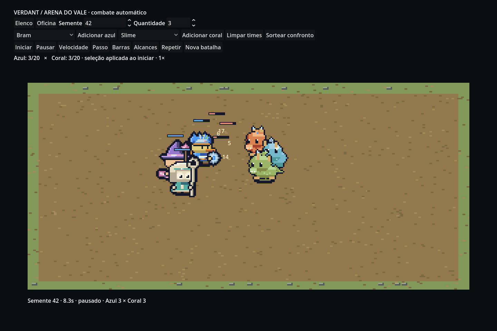

# Arena do vale

Uma arena top-down de uma tela foi escolhida para manter a leitura de aproximação, alcance e posição dos times. O plano nativo tem 320×150 pixels, desenhados sempre em 4×, nearest-neighbor, câmera fixa. Grama, terra e pedras ficam sob as sombras e sprites ordenados por Y. Uma margem superior reserva espaço para chefes e barras.



[GIF da simulação](battle/battle.gif)

## Montar e reproduzir

Entre por **Arena** na demo ou na oficina. Cada lado aceita até 20 integrantes, escolhidos entre os sete personagens, herói por semente e nove famílias de monstros. Escolha quantidade e use Adicionar azul/coral; repita para misturar classes. Limpar times recomeça a seleção. O monstro editado na oficina entra na primeira vaga coral ao abrir a arena por lá.

Iniciar congela as receitas e cria a `BattleSpec`. Sortear confronto escolhe uma nova semente visível; Repetir restaura exatamente a especificação anterior, mesmo se a seleção tiver mudado. Nova batalha incrementa a semente e sorteia novos times. Não há controle de personagem, progressão ou inventário. São dois times; livre-para-todos não faz parte desta versão.

Pausar, passo único (1/30 s), velocidades 1×/2×/4×, barras e alcances são independentes da simulação. O final mostra vencedor ou empate, dano e abates. O resumo de elencos muito grandes pode ocupar várias linhas; ainda não é uma tabela rolável por unidade.

## Regras

`battle/Sim` usa apenas C# e System.Numerics, sem Godot. `BattleSpec` contém semente, cópia somente-leitura dos integrantes e limite de ticks; registros de entrada/eventos são imutáveis. O estado da luta é mutável e isolado em `BattleSimulation`. Passo fixo de 30 Hz, ordem estável de ids, posições iniciais variam deterministicamente com a semente. Não há crítico aleatório. A reprodução é testada comparando **todos os eventos**, não só o vencedor.

| Perfil | Vida | Ataque | Defesa | Velocidade px/s | Alcance px | Recarga ticks |
| --- | ---: | ---: | ---: | ---: | ---: | ---: |
| Corpo a corpo | 115 | 19 | 3 | 25 | 20 | 27 |
| Tanque | 140 | 16 | 5 | 19 | 18 | 29 |
| Arqueiro | 90 | 19 | 1 | 24 | 75 | 28 |
| Mago | 85 | 16 | 1 | 22 | 65 | 32 |
| Curandeiro | 105 | 14 | 2 | 22 | 55 | 30 |
| Duelista | 95 | 14 | 2 | 34 | 19 | 19 |
| Investida | 110 | 20 | 2 | 26 | 20 | 33 |
| Cuspe | 95 | 18 | 2 | 23 | 65 | 30 |
| Enxame | 90 | 12 | 2 | 32 | 18 | 17 |

Arco/cajado/báculo/adagas/martelo escolhem arqueiro/mago/curandeiro/duelista/tanque. Outras armas usam corpo a corpo. Golem é tanque; dragão investe; aquático cospe; planta cura; alado é veloz; artrópode usa ataques rápidos de enxame (não invoca novas entidades); demais mordem. Monstros ganham `10 × raridade + massa` de vida, sendo raridade 0/1/2, e um ponto de ataque para gelo/sombra. Não há tabela de resistências elementais nesta versão.

A IA procura o inimigo próximo; tanques a menos de 60 px reduzem seu custo de seleção (provocação suave). Aproxima até o alcance, ataca ao completar recarga; arqueiro/mago/cuspe recuam quando com menos de metade da vida e inimigo a menos de 20 px. Cura prioriza o aliado mais ferido em até 80 px. Mago aplica metade do ataque a inimigos a menos de 20 px do alvo; dragão acelera 35% na aproximação longa. Projéteis levam oito ticks e acertam o alvo original se ainda vivo (sem interceptação física).

Dano = máximo de 1 e ataque − defesa, limitado à vida restante; quatro ticks de invulnerabilidade após acerto, knockback de 2 px. Separação simétrica de duas passagens evita sobreposição total; corpos têm raio lógico uniforme, inclusive chefes. Bordas são limitadas. Uma luta termina ao restar um time ou em 90 s (empate); projéteis pendentes não prolongam o resultado. Não há navegação por obstáculos: pedras são decorativas.

## Desenho e desempenho

`Arena` só apresenta estado e recebe controles. `SpriteCache` pré-calcula quadros e libera texturas ao trocar confronto/sair; não rasteriza criaturas por frame. Ataque, dano, morte, barras, números, projéteis e impactos usam a mesma escala. O custo inicial do cache acontece ao clicar Iniciar. Eventos são mantidos para reprodução; não são telemetria enviada externamente.

Medição real no Godot/Mesa llvmpipe, 20 integrantes e 360 quadros: mediana **9,37 ms**, p95 **12,97 ms**. Esse resultado fica abaixo do orçamento de 16,7 ms em pelo menos 95% da amostra, mas não garante 60 FPS em todo hardware ou em 40 integrantes. O driver virtual emite aviso de VSync indisponível.

## Evidências executadas

- `PixelPreview battle`: 240 confrontos mistos (60 deles com 20 integrantes), cada um executado duas vezes; 1.220 verificações, zero falhas. Compara eventos/vencedor, limite de tempo, atividade dos sobreviventes, existência de dano e vida/dano válidos.
- Taxas por classe/família de participação no time vencedor registradas em [balance-validation.log](battle/balance-validation.log). Todas ficaram entre 20% e 80%. Isso mede composições aleatórias em equipe, não equilíbrio isolado de duelos ou garantia estatística de balanceamento final.
- Godot real: 8 verificações da arena (times, iniciar, pausar, passo, 2×, 4×, término, repetição), 21 da oficina e 37 da demo do elenco.
- 166.626 verificações de arte no Godot e no PixelPreview; nenhum atlas antigo alterado.
- Revisadas visualmente: nove famílias em 5×, tiras de animações e capturas da arena/oficina. GIF contém 48 quadros avançando oito ticks entre capturas.

```sh
dotnet run --project tools/PixelPreview -- battle
./scripts/run.sh --headless -- --pixel-test
DISPLAY=:99 ./scripts/run.sh --audio-driver Dummy res://battle/Arena.tscn -- --battle-ui-test
DISPLAY=:99 ./scripts/run.sh --audio-driver Dummy res://battle/Arena.tscn -- --battle-capture
DISPLAY=:99 ./scripts/run.sh --audio-driver Dummy res://battle/Arena.tscn -- --battle-benchmark
```

Pontos ainda sujeitos a revisão: aprovação artística pelo usuário, balanceamento com mais composições, leitura em batalhas de 40 unidades e teste nativo do executável Windows. Não há multiplayer, save de partidas ou sistema de inventário.

## Builds desta entrega

ZIPs em `downloads/`, com PCK e runtime .NET incluídos. O executável Linux exportado passou 166.626 testes de arte, 8 da arena e 21 da oficina. Logs `linux-*-validation.log`. Windows foi exportado e o ZIP verificado; o `.exe` não foi executado neste ambiente. Extraia tudo e abra Verdant; entre na Arena pela demo.
