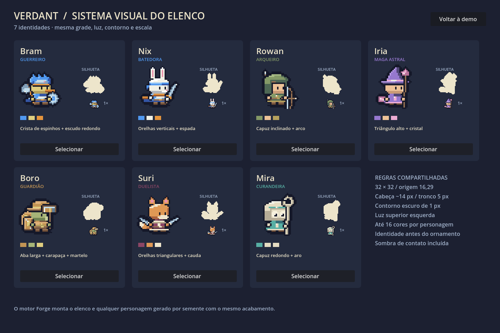

# VERDANT — sistema visual para expansão do elenco

O elenco tem sete identidades fixas (**Bram, Nix, Rowan, Iria, Boro, Suri e Mira**) e um gerador por semente. Todos são desenhados pelo motor **Forge** ([docs/FORGE.md](FORGE.md)), que aplica a mesma grade, contorno, luz e paleta a qualquer receita. A direção visual vem de referências em vídeo: cabeças grandes e arredondadas, contorno azul-noite contínuo, faixa/lenço azul como motivo comum, animais e humanos com a mesma anatomia mínima, armas com realce branco-gelo e sombra de contato escura sob os pés. Não há habilidades, balanceamento ou sistemas de combate.

## Gramática compartilhada

| Aspecto fixo | Regra de construção |
| --- | --- |
| Grade | Célula 32×32; nenhum redimensionamento do desenho para encaixar uma classe |
| Apoio | Origem (16,29), botas de dois pixels; mesmo plano de chão |
| Proporção | Cabeça-base próxima de 14 pixels, tronco de cinco; acessórios variam a altura total |
| Anatomia | Braços curtos, mãos de dois pixels, sem pescoço aparente |
| Contorno | Azul-noite `#151829`, predominantemente um pixel externo; contorno interno apenas para separar equipamentos |
| Luz | Superior esquerda; planos inferiores/direitos usam o tom de sombra |
| Materiais | Base + sombra; realce compartilhado em metal, marfim e tecido claro |
| Paleta | Até 16 cores visíveis por personagem/quadro; alfa somente 0 ou 255 |
| Escala | Nearest-neighbor, fatores inteiros; 4× é a escala padrão do cenário |
| Rosto | Olhos mínimos, leitura antes de detalhes; evitar boca, cicatriz e adorno competindo pelo mesmo espaço |
| Movimento | Deslocamentos de um pixel em idle, peças em fases distintas; pés estáveis |

Acessórios podem atingir os limites da célula, mas devem caber também durante ataques e mudanças de pose. Não se reduz o personagem inteiro para acomodar um cajado. Primeiro se redesenha a arma e seu arco de movimento.

## Matriz de identidades

A identificação deve sobreviver à remoção das cores. Cada classe ocupa uma combinação diferente de **forma dominante + equipamento + distribuição de massa**.

| Personagem / classe | Silhueta primária | Equipamento e leitura de classe | Paleta dominante | Personalidade visual |
| --- | --- | --- | --- | --- |
| Bram / guerreiro | Coroa ramificada e escudo lateral | Machado e escudo: combatente armado | Azul, gelo, dourado | Guarda firme; metais frios |
| Nix / batedora | Orelhas longas verticais | Espada curta e lenço: mobilidade | Branco, azul, cobre | Leve, alerta, orelha inquieta |
| Rowan / arqueiro | Capuz inclinado e arco curvo | Arco e aljava: distância | Verde, couro, marfim | Reservado; olhar lateral |
| **Iria / maga astral** | Triângulo alto e aba larga | Cristal em losango + grimório aberto | Violeta `#9678cf`, sombra `#514777`, rosa `#edacd3` | Curiosa e metódica; cristal acompanha a conjuração |
| **Boro / guardião** | Massa baixa e larga, formas retangulares | Carapaça, escudo-torre e martelo | Bronze `#c29454`, terra `#765740`, oliva `#a6b477` | Calmo e resistente; golpe de martelo descendente |
| **Suri / duelista** | Orelhas triangulares, cauda clara lateral | Duas adagas com espaços negativos visíveis | Laranja `#df9855`, vinho `#8c4665`, creme `#f0e6cd` | Ágil e provocadora; avanço curto e cauda em acompanhamento |
| **Mira / curandeira** | Capuz arredondado e aro vazado | Báculo circular + vestes claras | Jade `#57afa4`, petróleo `#356e78`, marfim `#e5dcc2` | Atenta e acolhedora; gesto de bênção com a mão livre |

Iria e Mira usam cajados, mas não a mesma linguagem: ponta triangular/cristal e chapéu pontudo para dano mágico; aro circular, capuz arredondado e superfícies claras para suporte. Boro não depende de parecer maior: a massa lateral e as formas quadradas comunicam resistência na mesma escala.

## O que variar e o que preservar

**Variar:** formato do acessório principal, massa lateral, espécie, combinação de materiais, arma, postura, ritmo de acessórios e combinação de cores.

**Preservar:** tamanho do núcleo da cabeça, altura do tronco, tamanho do pixel, origem, contraste do contorno, direção da luz, densidade de detalhes e escala no mundo.

Cada novo personagem deve ter uma forma dominante, uma arma/equipamento imediatamente legível e no máximo um acessório secundário importante. A personalidade vem da combinação dessas decisões. Não trocar apenas cores ou chapéus no mesmo desenho. Não tentar compensar uma silhueta fraca com joias, bordados ou muitos pixels isolados.

## Receita para um próximo integrante

1. Definir classe, personalidade e uma frase de reconhecimento: “silhueta X com equipamento Y”.
2. Consultar a matriz para evitar repetir a mesma dupla de forma e equipamento.
3. Desenhar primeiro a silhueta na célula 32×32 e comparar com o elenco a 1×.
4. Aplicar cabeça/tronco/apoio compartilhados. Preservar espaços entre cabeça, arma e mão.
5. Escolher três cores dominantes por papel: material principal, sombra e acento. Acrescentar somente os tons compartilhados realmente necessários.
6. Renderizar frente e costas nas cinco animações, mantendo a mesma origem. Conferir pose extrema de arma e acessórios.
7. Comparar a 1×, 2×, 4×, sobre fundo neutro e no cenário. Conferir o sprite monocromático ao lado do elenco.
8. Exportar PNG e atlas pelo mesmo renderer. Só então apresentar para aprovação artística.

## Critérios de revisão artística

- A classe é legível antes de ler o nome?
- A silhueta continua distinta em uma única cor?
- O equipamento pode ser identificado sem ampliar excessivamente?
- Há espaços claros entre arma, rosto e acessórios?
- O personagem parece da mesma escala e do mesmo artista que Bram, Nix e Rowan?
- Os olhos, as mãos e a roupa usam blocos comparáveis aos do elenco?
- A animação preserva a identidade e não faz os pixels decorativos piscarem?

Essas perguntas exigem inspeção visual. Os testes automatizados verificam propriedades técnicas; não substituem aprovação artística.

## Implementação e uso

- `pixel_demo/Forge/`: o motor. `ForgeCore` (papéis de cor, paleta, camada, primitivas), `ForgeParts` (cabeças por espécie, chapéus, tronco, costas), `ForgeGear` (armas e itens paramétricos por ângulo), `ForgeRenderer` (poses e composição), `ForgeRoster` (as sete receitas), `ForgeGenerator` (semente → receita) e `ForgeValidation` (regras objetivas).
- `RosterCatalog.cs`: catálogo tipado derivado das receitas; regras compartilhadas em `RosterVisualRules`.
- `CompactAdventurer.cs`: fachada estável (`Render(tempo, movimento, costas)`); os valores do enum `AdventurerKind` permanecem.
- `RosterBoard.cs` / `.tscn`: prancha Godot com sprite 4×, silhueta (sem sombra), versão nativa 1×, paleta e botão de seleção.
- `PixelDemo.cs`: seleção do elenco, geração por semente, espelhar, sombra, exportação e testes. O botão **Guia do elenco** abre a prancha.
- `docs/roster/`: PNGs, atlases, JSONs de animação, `catalog.json` (inclui a receita de cada personagem) e a galeria procedural (`generated.png/gif`, `generated-catalog.json`).

---
