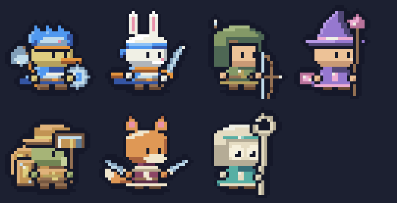
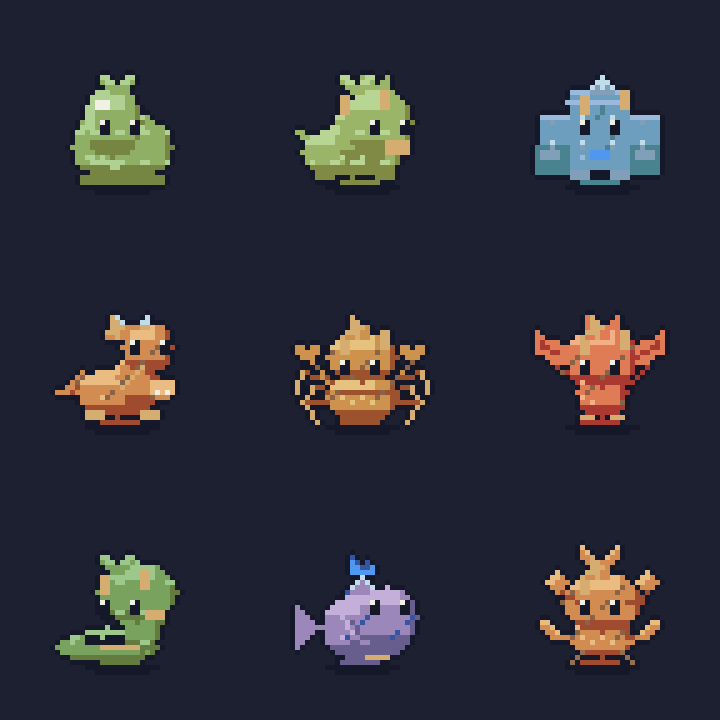
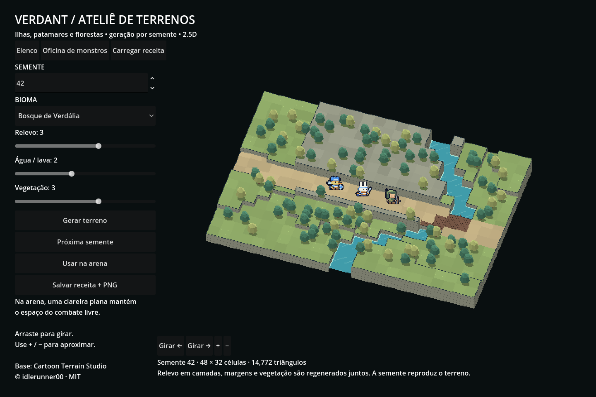

# Forge v2 — direção e auditoria M0

Base auditada: `terreno-generativo-25d`, commit `e2e96e3`. Referências: vídeo enviado pelo autor (160,067 s, **1024×576**, 30 FPS), imagens anexadas e a análise textual completa. A análise é um guia de observação, não código existente. Nenhum pixel, logotipo ou atlas da referência entra no jogo.

## Leitura visual da referência

Foram extraídos e inspecionados os quadros em 8, 16, 24, 32, 40, 48, 56, 72, 80, 88, 96, 104, 120, 128, 136 e 152 segundos. **Os tempos do vídeo recebido não coincidem exatamente com o índice do texto:** em 16 s ainda aparece a troca de peças, em 24 s aparece cor/luz, em 32 s espécies e em 48 s animação. O slide heráldico anexado foi inspecionado junto às imagens da mensagem. As extrações são material de análise temporário, não assets distribuídos.

| Observação | Regra original para VERDANT | Evidência de aceitação |
|---|---|---|
| 24 s: máscara, materiais, luz; seis cores | Contorno `#151829`; cinco tons quantizados por material; luz superior esquerda; sombra fria/realce quente | Folha M1 com as três etapas e seis equipes; só TEAM muda |
| 8–16 s: peças preservadas ao sortear uma | Fluxos nomeados estáveis, sem consumir o RNG de combate | M2 compara camadas não editadas byte a byte |
| 32/40 s: espécie + equipamento | Célula 32×32, origem (16,29), cabeça dominante; classe legível pela arma | M2 mede limites úteis e distância entre máscaras |
| 48 s: contato e costas | Norte construído; tempos por quadro; antecipação, impacto, recuperação | M3 quatro direções × cinco clipes, loops e pés |
| 56 s e prancha de bestas anexa | Seis anatomias, barding e movimento da mesma receita | M4 dez bestas sem substituir as nove famílias atuais |
| Prancha heráldica anexa | Campo, divisão e símbolo independentes; mesma identidade em bandeira/escudo | M5 oito famílias, 24 sementes cada, animação cacheada |
| 72–104 s: objetos, estados e vegetação | Materiais compartilhados; danos alteram geometria; detalhe em clusters | M6 variantes completas, flora e recursos originais |
| Imagens de biomas anexas | Terreno orgânico em chunks, sem textura por célula repetida | M7 comparar várias sementes/zoom e walkability |
| 120–136 s: lugares montados em etapas | Estradas/água antes dos lotes e detalhes | M7 assentamentos e caminhos conectados |
| 152 s: arte com dados | Atlas + JSON versionado, pivô/tempo/paleta/tags; mapa binário separado | M8 roundtrip e consumidor no Godot |

## Estado encontrado

- `ForgeRenderer` e `MonsterRenderer` usam `Layer`/`Tone`, acabamento comum e núcleo C# sem Godot. Elenco: 11 espécies, oito arquétipos gerados e sete heróis. Não há 45 espécies ou 20 classes.
- `ForgePalette` usa rampas de três tons (HSV e rampas curadas), com metal compartilhado. **Não usa OKLCH nem cinco tons.** A troca de Cloth já é viável, mas não existe um contrato independente TEAM para todas as categorias.
- O gerador usa um único `Rng` por receita. Não há fluxo por peça: alterar a sequência de sorteio desloca decisões posteriores.
- Heróis têm idle/walk/run/attack/hurt/Special/Cast; frente e costas, com espelhamento de apresentação. Não há quatro direções desenhadas nem morte articulada dos heróis. Monstros têm nove movimentos, mortes por família e fase visual de chefe.
- `SpriteCache` monta atlas antes da batalha; não gera pixels por frame. Chefes mantêm cache da segunda fase. A oficina de monstros usa esse cache.
- Terreno 2.5D existe: malha 48×32, quatro paletas, montanha, rio, pontes e árvores facetadas; trilha e clareira verificadas. Não é o terreno 2D pintado da referência. Não removê-lo para cumprir M7.
- `battle/Fx/` não existe nesta base. Há `ForgeEffects.cs` e desenho de efeitos em `Arena.cs`. PR #7 pertence a outro branch e não foi incorporado silenciosamente.
- Não há run, guerra ou exércitos persistentes implementados. Os cinco reinos são direção documentada. Heráldica futura liga-se a identidades visuais, não cria regras de jogo.
- `docs/QUALITY.md` é relatório histórico do addon legado; suas métricas não descrevem a Forge atual. Validações e hashes atuais acompanham esta entrega.

## Crítica dos renders atuais

Imagens geradas do código e abertas para revisão. Bram, Nix e Iria têm assinatura imediata por elmo, orelhas e chapéu. Rowan depende bastante do arco: o capuz engole parte da cabeça. Boro tem boa massa lateral, mas martelo e escudo ocupam um bloco visual denso. Suri tem cauda clara e lâminas distintas; o lenço se funde ao tronco. Mira lê pelo aro do báculo, mas o rosto e o capuz claros têm pouco contraste interno.

Nos monstros, dragão, artrópode e planta já se distinguem; slime e besta verdes ainda compartilham massa/coroa excessivamente parecidas. Os dois ficam visualmente mais próximos quando reduzidos a 1×. O golem tem bons punhos, mas olhos e brilho ficam pequenos no rosto largo. Rampas da serpente/planta deixam planos adjacentes pouco separados. M1 pode melhorar cor e luz; não resolve anatomia.

O terreno tem profundidade e água legíveis, porém grade 2×2, trilha retilínea larga e árvores repetidas diferem bastante da referência pintada. Recolorir não resolverá isso. Construções, flora em sprites e composição orgânica ficam para M6/M7.

## Contrato de coexistência

O manifesto `arte/estilo-v2/antes/atlas-sha256.json` preserva 5.328 hashes RGBA do elenco, gerados e monstros. A opção **Estilo v2** começa desligada. O caminho desligado deve produzir os mesmos bytes, incluindo especiais e fases atuais. Nenhum arquivo de `battle/Sim` ou dado de balanceamento será alterado. O padrão só pode mudar após comparação visual final; esta primeira entrega não o muda.

## Decisões e marcos

M0 é auditoria/documentação, sem código de jogo. M1 trata materiais/luz e provas usando a geometria atual; **não será anunciado como personagens v2 prontos**. M2 altera receitas/anatomia por ondas começando nas 11 espécies. M3 acrescenta direções/animação. M4 bestas; M5 heráldica. M6–M8 só entram depois de os anteriores passarem pela revisão visual.

Célula de personagem permanece 32×32. Medir a caixa útil por receita exportada, sem prometer que acessórios de 28 px cabem em 20 px. Limite novo: **32 cores opacas por quadro**, cinco por material mais tinta; o estilo antigo conserva seu limite de 16. Tabelas de cor são calculadas offline em OKLCH e armazenadas em bytes. Nenhuma conversão perceptual acontece durante frames do jogo.

M1 deve entregar paletas, luz comum, folha em formato de apresentação original VERDANT, comparação antes/depois e leitura 1×/2×/3× em fundos claro/escuro. A base 3D continua disponível; a proposta M7 é um renderer 2D por chunks adicional, usando os mesmos materiais e sem apagar a base anterior.
