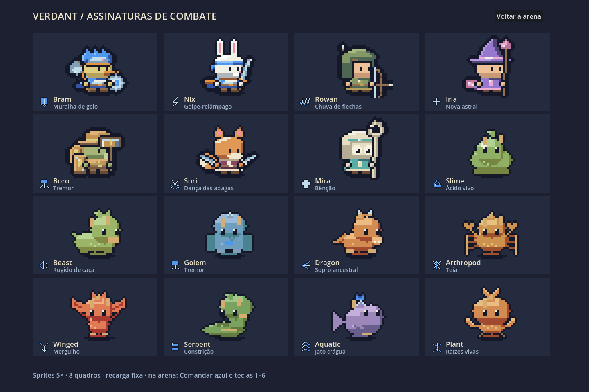
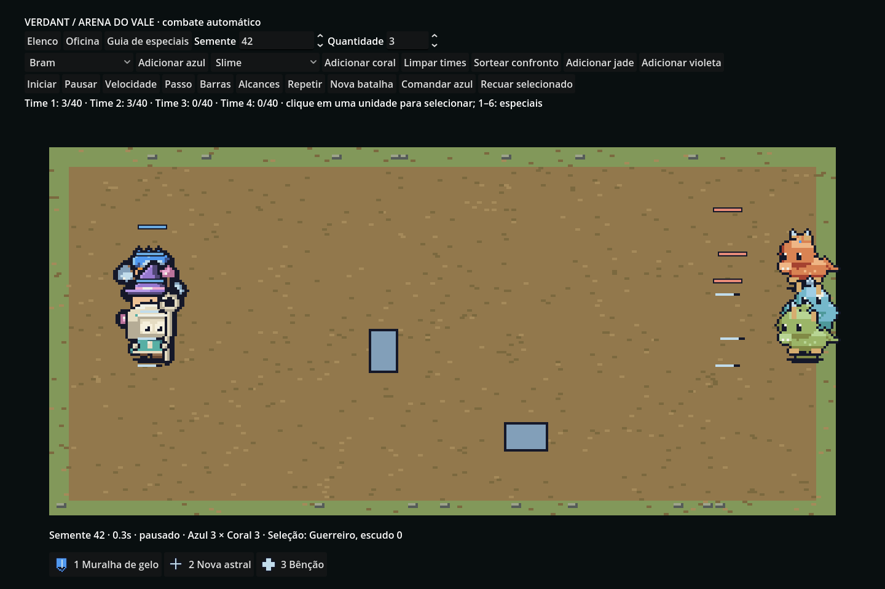

# Especiais — marco 1

Esta entrega amplia a oficina e a arena existentes. Campanha, nações, incursões, guerra territorial e save de campanha pertencem aos próximos marcos. O guia na arena mostra os sete heróis e nove famílias em escala 5×.



## Jogar

Abra **Arena**, monte os times azul/coral/jade/violeta e inicie. A interface aceita 40 unidades por time; a simulação aceita N times e até 256 unidades, incluindo invocações. A medição gráfica desta entrega cobre 40 unidades iniciais, não 160.

**Comandar azul** permite disparar os especiais dos primeiros seis aliados com 1–6 ou pelos ícones. Passe o mouse sobre um ícone para consultar efeitos e recarga. Clique para selecionar; botão direito dá ordem de movimento para um aliado. Recuar retira o aliado selecionado ao alcançar a borda. Pausa, passo e velocidades 1×/2×/4× continuam disponíveis. **Repetir** reaplica os comandos aceitos nos mesmos ticks, com a mesma semente. Na oficina, escolha **Especial** para substituir a assinatura da família e visualize os movimentos **Special/Cast** antes de enviar à arena.

## Regras e dados

`battle/Sim/Abilities.cs` centraliza os 16 especiais, efeitos e associações. Recarga fixa de 7 segundos, conjuração de 0,4 segundo e disponibilidade inicial após 2 segundos: não há barra de energia. O custo é o tempo sem atacar e a oportunidade de usar a recarga. Dano pode interromper a conjuração com chance determinística de 30%; atordoamento sempre interrompe. Interromper não devolve a recarga.

| Elenco | Especial | Identidade |
|---|---|---|
| Bram | Muralha de gelo | Escudo próximo e provocação |
| Nix | Golpe-relâmpago | Avanço, corte e recarga zerada ao matar com o golpe |
| Rowan | Chuva de flechas | Círculo de dano e sangramento |
| Iria | Nova astral | Explosão e lentidão |
| Boro | Tremor | Dano próximo, atordoamento e provocação |
| Suri | Dança das adagas | Três impactos e esquiva temporária |
| Mira | Bênção | Cura e escudo próximos |

| Família | Especial |
|---|---|
| Slime | Ácido vivo: linha e veneno |
| Besta | Rugido de caça: enfraquecimento e investida |
| Golem | Tremor |
| Dragão | Sopro ancestral: cone e queimadura |
| Artrópode | Teia: área e imobilização |
| Alado | Mergulho: avanço, dano e empurrão |
| Serpente | Constrição: imobilização e veneno |
| Aquático | Jato d'água: linha e empurrão |
| Planta | Raízes vivas: imobilização próxima e regeneração |

Gerados recebem assinatura pelo papel derivado de classe/equipamento: tanque→tremor, arqueiro→chuva, mago→nova, curandeiro→bênção, duelista→dança, investida→rugido, cuspidor→ácido, enxame→teia, corpo a corpo→golpe-relâmpago. Fogo acrescenta queimadura; gelo, lentidão; planta, raízes; veneno, DOT; sombra, dreno. Chefes mudam para Chamado da alcateia abaixo de 50% da vida: vigor e até duas invocações por chefe, respeitando o limite global.

Veneno, queimadura e sangramento acumulam até três camadas, renovando a duração; demais estados renovam a duração e conservam a maior potência. DOT e regeneração pulsam a cada 30 ticks globais. Estados expiram por tick e são removidos na morte. Escudo absorve dano após defesa, com teto de 60. Dreno cura metade do dano realmente tirado da vida. Efeitos respeitam aliados/inimigos, alcance e linha de visão. A IA usa cura quando existe aliado abaixo de 40% e espera três inimigos agrupados para áreas quando existem pelo menos três inimigos vivos.

## Simulação e apresentação

C# puro, passo de 30 Hz, eventos imutáveis e comandos registrados em `BattleInputs.cs`. A mesma especificação e sequência de comandos reproduzem os eventos. O log de comandos pode ser serializado em JSON; isto ainda não é save de campanha.

Retângulos bloqueiam movimento, visão e projéteis. Projéteis percorrem uma trajetória e atingem o primeiro inimigo interceptado. Movimento usa deslizamento simples nas bordas; não é um navegador para labirintos arbitrários. Empurrões/investidas respeitam colisão. A arena inclui dois obstáculos físicos.

Forge produz Special/Cast com oito quadros por receita, reutilizando as poses de ataque e acrescentando runas/traços da paleta. O acabamento, alfa binário e limite de 16 cores são validados. Ícones 16×16 têm símbolos distintos e três cores. Efeitos de batalha representam linhas, cones e círculos; a galeria e as folhas em `docs/specials` permitem revisão em 5×. Os 42 PNGs nativos/atlases anteriores do elenco permanecem idênticos. Cache por atlas e receita evita rasterizar durante a luta; invocações compartilham o cache do pai.



## Validação executada

Godot 4.5.2 .NET, SDK 8.0.408, Linux, Mesa llvmpipe. Saídas completas em [logs](specials/logs/).

- Arte: **209.682 verificações, zero falhas**, tanto no PixelPreview quanto no Godot.
- Especiais: **39 verificações, zero falhas**, incluindo recarga, áreas, interrupção, expiração, invocações, obstáculos, interceptação e replay de comandos JSON.
- Batalha: **240 sementes com + 240 sem especiais**, **1.220 verificações por conjunto**, zero falhas. Todos os eventos são comparados; vida, término e inatividade também são verificados.
- UI real: **13 arena + 24 oficina + 37 elenco**, zero falhas.
- Benchmark isolado: **42 combatentes** (40 iniciais + invocações), 360 quadros, mediana **11,72 ms**, p95 **15,23 ms**. Esta é a medição desta máquina, não garantia para qualquer equipamento.
- Participação em vitórias por classe/família: **27,7–75,9% com especiais**, **28,2–59,4% sem especiais**. São times mistos, com invocações incluídas, e não duelos isolados. Nenhum grupo fora de 20–80%; o ganho da curandeira e a queda da maga astral merecem acompanhamento em novos cenários.

A antiga verificação de inatividade exigia um evento emitido por cada sobrevivente, confundindo invocações recentes e controle recebido com travamento. Agora mede ticks consecutivos sem movimento, ataque, conjuração ou impedimento, exigindo menos de dez segundos.

```bash
dotnet run --project tools/PixelPreview -- check 200
dotnet run --project tools/PixelPreview -- special-check
dotnet run --project tools/PixelPreview -- battle
dotnet run --project tools/PixelPreview -- battle-no-specials
dotnet run --project tools/PixelPreview -- specials docs/specials
./scripts/run.sh --headless -- --pixel-test
./scripts/run.sh --audio-driver Dummy res://battle/Arena.tscn -- --battle-ui-test
./scripts/run.sh --audio-driver Dummy res://workshop/Workshop.tscn -- --monster-ui-test
./scripts/run.sh --audio-driver Dummy -- --pixel-ui-test
./scripts/run.sh --audio-driver Dummy res://battle/Arena.tscn -- --battle-benchmark
./scripts/run.sh --audio-driver Dummy res://battle/SpecialGallery.tscn -- --special-capture
```

Os testes gráficos exigem display. O driver desta máquina avisa que não pode alterar VSync; os testes e capturas terminaram normalmente. Builds Windows e Linux incluem o runtime .NET. O executável Windows não foi executado neste ambiente Linux. Resultados da build Linux exportada ficam nos logs `linux-*`.

## Camada visual dos efeitos (`battle/Fx/`)
Apresentação pura em C#: `FxDirector` lê eventos/estado da simulação a cada tick (`Advance()`), `Collect()` produz três listas (Ground/Over/Top) de sprites de um único atlas (`FxAtlas`). Nada escreve na simulação.
- **Quatro fases por especial:** telégrafo (0,4 s de conjuração: forma real — círculo, cone, linha — com o alcance do simulador), liberação, impacto (hit-stop de 2–3 ticks e tremor opcionais, só na arena) e resíduo.
- **Linguagem:** dano vermelho/laranja/branco; cura verde/branco; escudo ciano; controle com ícone próprio + cor (nunca só cor). Temas: `FxTheme` (rampa de 4 tons + tinta).
- **Estados:** ícone 9×9 (até 3 por unidade, prioridade em `StatusIcons.Priority`) e camada no corpo.
- **Pixel art:** alfa 0/255, ≤16 cores por quadro, sem escala fracionária; atlas gerado uma vez e cacheado.
- **Orçamento:** 200 partículas e 420 pontos de forma por quadro. Cheio, a nova partícula troca a mais antiga de prioridade menor (decoração < impacto < informação), senão é descartada.
- **Controles:** botões "Efeitos" e "Tremor" na arena.
- **Criar um efeito novo:** registrar sprites em `FxAtlas.Build`, escrever o caso em `FxScripts.Release` (e telégrafo em `DrawTele`), rodar `fx-check`.
- Validação: `dotnet PixelPreview.dll fx-check`.
