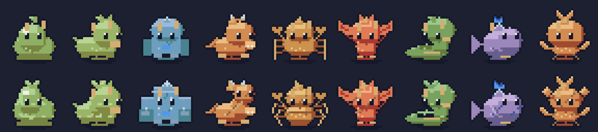

# Monstros Forge — revisão de arte

As nove famílias usam `MonsterSpec`, `Layer`, `Tone`, `ForgePalette` e `ForgeFinish`, em C# puro. Nenhum personagem foi pintado fora do Forge. A revisão altera arte e apresentação; simulação, receitas de combate, números de habilidades e efeitos de `ForgeEffects` permanecem iguais.



## Linguagem e anatomia

Contorno azul-noite `#151829`, luz superior esquerda, rampas de sombra/base/luz, alfa 0/255 e no máximo 16 cores por quadro. Detalhes são agrupados em planos, veios e manchas aderidos à superfície, sem ruído aleatório. A paleta conserva os papéis do elenco; seus sprites e atlases não mudam.

| Família | Assinatura e movimento |
|---|---|
| Slime | Massa contínua, brilho largo, compressão elástica e morte em poça |
| Besta | Ombros altos, focinho, apoio alternado e queda para a frente |
| Golem | Cabeça blocada, ombros/punhos grandes; antecipa os braços e desmonta em blocos rígidos |
| Dragão | Cabeça elevada, pescoço alongado e cauda com atraso no movimento e na morte |
| Artrópode | Abdômen segmentado, joelhos angulares; recolhe membros na morte |
| Alado | Membranas e batimento secundário; cai antes de fechar as asas |
| Serpente | Espiral com espaço negativo; cabeça desliza e espiral se abre ao cair |
| Aquático | Nadadeiras com nervuras, cauda atrasada e corpo que murcha |
| Planta | Copa e folhas agrupadas, ramos flexíveis; seca e se curva |

As cinco características 0–3 continuam na receita: massa, cabeça, apêndices, padrão e cor. Alterações em cabeça/largura dos ombros/posição da cauda corrigem a baixa variedade de slime, golem e aquático. A receita JSON não mudou e nenhuma migração é necessária. Não há promessa de 4⁵ silhuetas únicas: traços discretos podem coincidir em pixels; veja a contagem por família na auditoria.

## Elementos, raridades e chefes

Fogo usa uma crista que oscila e veios pulsantes; gelo tem facetas e brilho alternado; planta tem folhas que abrem/fecham e musgo; veneno tem bolhas e manchas em clusters; sombra tem crista irregular e sulcos escuros. Essas camadas são calculadas junto com cada quadro do atlas, não como partículas em tempo real. Família e elemento continuam independentes; as matrizes `monsters/*-elements-ranks.png` mostram as 45 combinações, nas três raridades e na segunda fase do chefe.

Comum permanece sem armadura; elite acrescenta coroa e placas; chefe usa célula 48×48, com ombros, asas, raízes, cauda ou massa adicional conforme a família. A fase visual 1 acrescenta fissuras e sobrancelhas agressivas. A arena lê o `Fighter.Phase` que já existia; não altera o gatilho de 50% da vida nem habilidades. A oficina permite alternar a fase visual independentemente do combate.

Minion/elite: célula 32×32, origem (16,29). Chefe: 48×48, origem (24,45). Não há ampliação dos pixels para construir a anatomia do chefe.

## Animações e cache

| Movimento | Quadros | FPS | Comportamento |
|---|---:|---:|---|
| Idle | 16 | 8 | Respiração, piscar, apêndices e elemento; loop |
| Walk / Run | 8 | 8 / 12 | Apoios e movimento secundário por família; loop |
| Attack | 6 | 8 | Antecipação, impacto e recuperação |
| Hurt | 4 | 8 | Recuo e flash |
| Death | 8 | 12 | Trajetória por família; quadro 7 totalmente transparente |
| Special / Cast | 8 | 8 | Poses de ataque atualizadas, efeitos anteriores preservados |
| Entry | 8 | 8 | Aterrissagem curta; sombra/origem fixas; termina em idle |

`Entry` foi acrescentado ao fim do enum; valores antigos foram preservados. A morte cabe no período de apresentação já existente na arena (23 ticks); não foi necessário mudar a simulação. A entrada é mostrada nos primeiros 24 ticks dos chefes. O elenco mantém suas contagens e tempos anteriores.

`SpriteCache` rasteriza ao construir o atlas, compartilha receitas idênticas e mantém a segunda fase apenas para chefes. A oficina usa `AtlasTexture` diretamente em escala inteira 8×; deixou de ler, ampliar e criar uma textura a cada quadro. Orçamento RGBA sem mipmaps por receita: comum/elite 256×320 = 320 KiB; chefe duas folhas 384×480 = 1.406 MiB. Quarenta receitas comuns distintas ocupam cerca de 12,5 MiB de pixels, além dos objetos e texturas da cena.

## Oficina, exportação e extensão

Família, semente, cinco características, elemento, raridade, mutação, cruzamento, desfazer/refazer e especiais continuam editáveis. Selecione uma animação, frente/costas, pausa/passo ou **Fase visual do chefe**. Exportar escreve PNG, nove atlases e JSON em `user://monsters/`; o JSON inclui `visualPhase`. A receita enviada à arena permanece a mesma.

Ao estender arte, altere a anatomia em `MonsterRenderer` e os movimentos/camadas em `MonsterArt`; mantenha tons sem cores diretas e margens transparentes. Não acrescente regras de combate para corrigir um problema visual. Amplie a matriz de validação e revise primeiro os extremos das poses, depois elementos e chefes. Consulte a [auditoria e pendências visuais](ARTE-MONSTROS-AUDITORIA.md).

```sh
dotnet run --project tools/PixelPreview -- monsters docs/monsters
python3 scripts/monster-art-review.py # Pillow; só compõe pixels já exportados pelo Forge
dotnet run --project tools/PixelPreview -- check 200
dotnet run --project tools/PixelPreview -- special-check
dotnet run --project tools/PixelPreview -- battle
dotnet run --project tools/PixelPreview -- battle-trace /tmp/events.json
./scripts/run.sh --headless -- --pixel-test
./scripts/run.sh --headless res://battle/Arena.tscn -- --battle-validation
DISPLAY=:99 ./scripts/run.sh --audio-driver Dummy res://workshop/Workshop.tscn -- --monster-ui-test
DISPLAY=:99 ./scripts/run.sh --audio-driver Dummy res://battle/Arena.tscn -- --battle-ui-test
DISPLAY=:99 ./scripts/run.sh --audio-driver Dummy res://battle/Arena.tscn -- --monster-art-capture
DISPLAY=:99 ./scripts/run.sh --audio-driver Dummy res://battle/Arena.tscn -- --battle-benchmark
```

[Relatório de execução e benchmark](arte/RELATORIO.md) · [GIF real na arena](arte/arena-monstros.gif) · [Pranchas e GIFs 8×](arte/depois/) · [Leitura 2×](arte/leitura-2x.png) · [Leitura 3×](arte/leitura-3x.png).

A oficina 192×160 continua separada em Modo legado. Esta revisão não é uma entrega da run, de Android ou de web.
