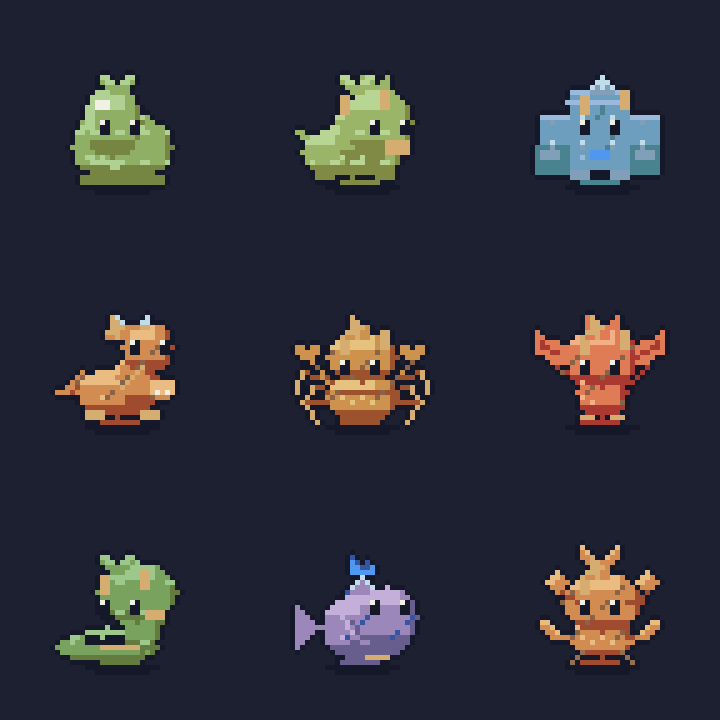

# Monstros Forge

A oficina principal agora monta monstros usando `MonsterSpec`, `Tone`, `ForgePalette`, `Layer` e o mesmo acabamento `ForgeFinish` do elenco. O renderer 192×160 permanece em **Modo legado**, com cena própria e botão de retorno; ele não participa da arena. Os 42 PNGs/atlases nativos do elenco foram comparados byte a byte e permaneceram idênticos.



Ordem da prancha: slime, besta quadrúpede, golem, dragão pequeno, artrópode, alado, serpente, aquático e planta. A família decide corpo, apoio, cabeça e apêndices naturais; só o alado recebe asas. Elementos fogo/gelo/planta/sombra/veneno mudam rampas e um adorno conectado à cabeça. A família e o elemento são independentes: um dragão pode ser de gelo.

## Receita e edição

`MonsterSpec` é um registro imutável com seed, família, elemento, raridade e cinco características discretas (0–3): massa, cabeça, apêndices, padrão e variação de cor. `MonsterGenerator.Generate(seed)` é determinístico. Minion/elite têm célula 32×32 e origem (16,29); chefe tem célula fixa 48×48 e origem (24,45), massa corporal e adornos adicionais desenhados em pixels nativos. Elite recebe uma pequena coroa. Não existe escala fracionária de anatomia.

A oficina oferece família, semente, Gerar/Sortear, sliders, elemento, raridade, mutação, captura do pai B, cruzamento de pais da mesma família e desfazer/refazer. `Mutate` recombina características com uma nova semente; `Cross` herda campos dos dois pais. Família, elemento e raridade continuam explícitos e editáveis. O botão Arena leva a receita atual para a primeira vaga coral.

A prévia tem idle/walk/run/attack/hurt/death, frente/costas, pausa e passo. PNG e seis atlases + JSON são exportados para `user://monsters/`; metadados incluem receita, célula, origem, FPS, número de quadros, estado, loop e orientação. Arquivos com o mesmo identificador são substituídos.

## Movimento e estilo

Pixels opacos ou transparentes; até 16 cores; tinta azul-noite `#151829`; sombra de contato; rampas com sombra fria e realce superior esquerdo. Idle respira sobre apoio fixo. Pernas alternam, asas batem e corpos sem pernas deslizam. Ataque tem seis poses de antecipação/avanço/impacto/retorno; dano usa flash branco e recuo. Morte comprime a silhueta em seis quadros e termina transparente, removível em 0,75 s. Caminhada e corrida têm oito quadros; idle tem 16; dano quatro. São animações compactas: a morte compartilha o mesmo tratamento entre famílias, e não há uma animação física diferente para cada elemento.

Prévias a 5×: [idle](monsters/all-idle-review.png), [walk](monsters/all-walk-review.png), [attack](monsters/all-attack-review.png), [hurt](monsters/all-hurt-review.png), [morte](monsters/all-death-review.png). Há também tiras individuais de todas as famílias, incluindo run. [Galeria por semente](monsters/generated.png) · [oficina capturada no Godot](monsters/workshop.png).

## Estender e testar

Uma nova família exige um enum, uma composição de peças em `MonsterRenderer`, comportamento em `BattleRecipes` e amostras na validação. Use as mesmas primitivas e paleta. A margem transparente ao redor da célula é testada além de `Raster.Clipped`, para detectar contornos truncados. Nenhuma verificação antiga do elenco foi reduzida.

```sh
dotnet run --project tools/PixelPreview -- monsters docs/monsters
dotnet run --project tools/PixelPreview -- strip /tmp/slime.png monster:slime death 5
dotnet run --project tools/PixelPreview -- check 200
./scripts/run.sh --headless -- --pixel-test
DISPLAY=:99 ./scripts/run.sh --audio-driver Dummy res://workshop/Workshop.tscn -- --monster-ui-test
```

Validação executada: 56.374 verificações de monstros (129 receitas, todas as animações, frente/costas, limites, alfa, paleta, determinismo, loops, base fixa, pixels órfãos, morte removível, ≥110/120 sementes distintas e nove silhuetas familiares distintas). Somadas às 110.252 do elenco, são 166.626. Teste real de UI: 21 verificações. Os logs estão nesta pasta em `monsters/*validation.log`. Aprovação artística final continua sendo visual, não uma conclusão dos testes.

## Atualização: marco 1 de especiais

Consulte [ESPECIAIS.md](ESPECIAIS.md) para as regras atuais, movimentos Special/Cast, edição na oficina, quatro times na arena, obstáculos e validação. As métricas acima descrevem a entrega anterior; as métricas atuais e logs ficam no novo relatório.
