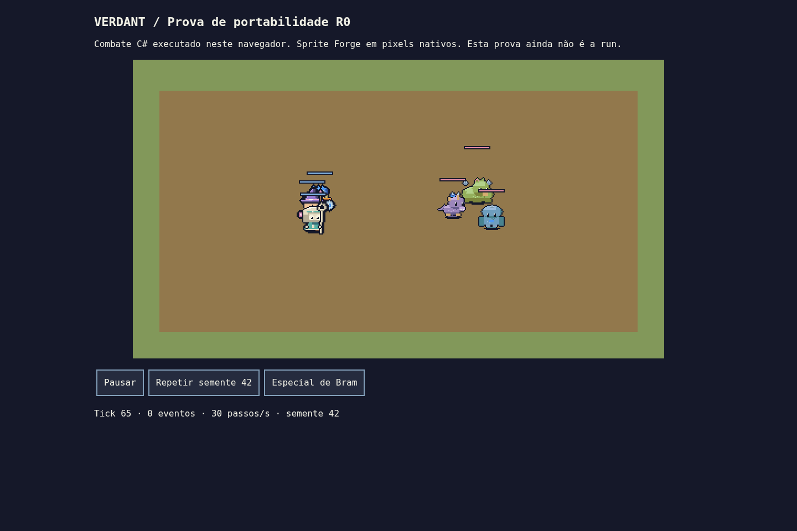

# Portabilidade — auditoria e prova R0

Data: 2 de novembro de 2026. Base auditada: `extracao-e-guerras`, commit `2939397`. Nova direção: [roguelike de runs](ROGUELIKE.md). Esta entrega prepara o núcleo; não entrega a run nem certificação mobile.

## Estado encontrado e separação

`battle/Sim` já era C# puro com `System.Numerics.Vector2`. Forge usava `Godot.Color`; `Raster` usava Color, Vector2 e Image; `RosterCatalog` usava Vector2I. PixelPreview compilava cópias dessas fontes contra `GodotShim.cs`. Isso permitia testes sem editor, mas não constituía uma biblioteca independente do motor.

Agora `core/Verdant.Core.csproj` é uma biblioteca .NET 8, sem pacotes ou referências Godot. Inclui os arquivos existentes de batalha, receitas, Forge, Raster e catálogo por links de compilação, sem duplicar implementações. Jogo e PixelPreview referenciam a mesma biblioteca. `Rgba` e `PixelPoint` são tipos próprios; geometria do raster usa System.Numerics. `GodotRaster` converte RGBA para Image e mantém adaptadores de Color/Vector2 para as cenas e renderer legado. O addon continua autocontido ao ser copiado, incluindo Rgba e o adaptador.

GodotShim foi removido. `SpriteCache`, cenas e criação de texturas continuam na apresentação. A lógica de batalha não mudou. `run/Sim` será adicionado à biblioteca em R1; não foi criado um núcleo de run fictício nesta etapa.

### Identidade dos pixels

`ForgeHashes` calcula SHA-256 sobre os bytes RGBA de todos os quadros concatenados de cada animação/orientação: sete heróis + 200 sementes, e nove famílias × três raridades × cinco elementos. Inclui Special/Cast, frente/costas e chefes 48×48.

**5.058 hashes, zero diferenças** entre: Godot original, shim original, biblioteca pura e Godot usando o adaptador. Manifesto [atlas-sha256.json](portability/atlas-sha256.json); [log](portability/logs/pixels.log). Não houve alteração intencional de arte, nem regeneração dos PNGs existentes. A aritmética de cor e a truncagem para bytes foram preservadas. O teste cobre esta amostra, não todas as sementes possíveis.

```sh
dotnet build core/Verdant.Core.csproj
dotnet run --project tools/PixelPreview -- pixel-verify docs/portability/atlas-sha256.json
./scripts/run.sh --headless -- --forge-hashes
```

## Android oficial

Fontes consultadas da documentação **4.5**, correspondente ao editor 4.5.2:

- [Exporting for Android](https://docs.godotengine.org/en/4.5/tutorials/export/exporting_for_android.html): C# exporta desde 4.2, mas o suporte é **experimental**; requisitos de JDK/SDK.
- [C# platform support](https://docs.godotengine.org/en/4.5/tutorials/scripting/c_sharp/index.html#c-platform-support): confirma Android experimental e ausência de web C# oficial.
- [Código do exportador 4.5.2](https://github.com/godotengine/godot/blob/4.5.2-stable/platform/android/export/export_plugin.cpp): opções dos presets.

`export_presets.cfg` adiciona **Android Debug** (APK) e **Android Release** (AAB), somente `arm64-v8a`, Gradle, sem permissão Internet. Renderer continua `gl_compatibility`. Nenhum keystore ou senha foi incluído. A interface atual ainda é desktop; o layout mobile completo é R3.

Preparação em uma máquina com SDK:

1. Instalar Godot 4.5.2 .NET e templates mono, SDK .NET 8 e OpenJDK 17 (a documentação recomenda 17).
2. Instalar Android platform-tools ≥35, build-tools 35.0.0, plataforma 35, command-line tools, CMake 3.10.2.4988404 e NDK 28.1.13356709, conforme a documentação 4.5.
3. Configurar Java SDK Path e Android SDK Path no editor. Instalar **Android Build Template** pelo menu Project. Templates devem corresponder à versão mono do editor.
4. Configurar o keystore de depuração localmente. Para AAB, configurar chave de release e credenciais locais/variáveis de ambiente documentadas pelo Godot; nunca versioná-las. Revisar application ID e versão antes de publicar.
5. Executar:

```sh
./scripts/run.sh --headless --export-debug 'Android Debug' /tmp/Verdant.apk
./scripts/run.sh --headless --export-release 'Android Release' /tmp/Verdant.aab
adb install -r /tmp/Verdant.apk
```

**Tentativa real nesta máquina:** export-debug recusado por ausência de Android SDK (adb/apksigner), android_source.zip/template Gradle instalado e Java SDK Path configurado. Há Java 21, mas nenhum SDK Android ou dispositivo/emulador disponível. [Saída integral](portability/logs/android-export.log). **APK não gerado nem executado; AAB não gerado; nenhum teste Android realizado.** Não instalamos SDKs nem assinamos artefatos fingindo suporte validado.

## Navegador: opções

| Opção | Reutiliza | Esforço e risco | O que precisa mudar |
|---|---|---|---|
| (a) Fork Godot .NET web | Cenas, C#, UI e Forge | Menor adaptação inicial de UI; alto risco de manutenção do fork/runtime e integração de templates | `net9.0`, SDK/workload e templates próprios; limitações de BCL/globalização/GDExtension e hospedagem |
| (b) Núcleo C# + apresentação HTML/canvas em .NET WebAssembly | Toda simulação, dados, Forge/atlases e testes | Esforço médio/alto de UI separada; dependência no runtime web padrão, risco de duplicar apresentação | Godot Control/Input/Image não passam ao browser; canvas, toque, áudio e armazenamento web próprios |
| (c) Portar apresentação para Godot/GDScript | Layouts/recursos e atlases | Sem caminho oficial para chamar o núcleo C# no browser; esforço alto para manter regras equivalentes | Portar só UI não basta: seria necessário portar também regras ou criar bridge WASM própria; risco de divergência |

**Recomendação: (b)** como camada web separada sobre a biblioteca compartilhada, mantendo Godot .NET para desktop/Android. Avançar apenas com testes de equivalência; a prova não estabelece que uma UI web completa seja barata.

O [fork indicado](https://github.com/ComplexRobot/godot-dotnet-web-export/tree/master) foi lido na branch `master`: README exige `net9.0`, SDK 9, `wasm-tools`, templates próprios e `Program.cs`; descreve binários preparados para Windows, globalização invariante, indisponibilidade de algumas APIs BCL (por exemplo crypto) e ausência de GDExtensions. Menciona SharedArrayBuffer para itch.io. Não compilamos nem executamos esse fork. Nosso Godot permanece oficial 4.5.2 e `net8.0`.

### Prova executada

`tools/WebProof` usa Blazor WebAssembly como carregador/interop e canvas 480×270. A batalha e o Forge executam **dentro do navegador**, sem servidor de lógica. Seis unidades, semente 42, sprites gerados uma vez e armazenados em cache; botões de pausa, repetição e especial. A prova desenha caminhada e barras, sem toda a apresentação de estados da arena.

Publicação .NET 8 realizada sem AOT/trimming, aproximadamente **39 MiB descompactados**. Esse tamanho é deliberadamente de investigação e ainda precisa ser otimizado. A restauração de dependências precisa de rede; a aplicação carregada não usa serviços externos. Save web/IndexedDB, retomada mobile e modo instalável/offline não estão implementados.

Teste Chromium real, headless:

- Combate completo no WASM: **222 eventos iguais**, inclusive posições, comparados com o CLI nativo.
- Reinício por toque simulado em **1280×720, 1440×720 e 1600×720**; três botões com largura/altura ≥48 pixels CSS. Isso é evidência da prova HTML, não validação de dp/notch Android nem da futura UI Godot.
- [Captura](portability/web-proof.png) e [saída](portability/logs/web-browser.log). Instruções reproduzíveis em [tools/WebProof](../tools/WebProof/README.md).



## Regressão e limitações medidas

- Forge + MonsterValidation + ícones: **209.682 verificações**, zero falhas, no CLI e Godot.
- SpecialValidation: **39**, zero falhas. BattleValidation: **240 batalhas duplicadas / 1.220 verificações**, zero falhas; taxas e eventos preservados.
- UI Godot: **13 arena + 24 oficina + 37 elenco**, zero falhas.
- Renderer legado: **10.039 verificações**, zero falhas, após os adaptadores.
- Benchmark atual de 40 unidades iniciais (42 com invocações): mediana **13,51 ms**, p95 **19,61 ms**, em Linux/Mesa llvmpipe. O p95 excede 16,67 ms; cabe em 33,33 ms nesta amostra. Não é resultado de celular nem garantia de 30 FPS em dispositivo.

- Benchmark pequeno de 12 unidades iniciais (**13 com invocação**): mediana **11,64 ms**, p95 **17,38 ms**. Também excedeu ligeiramente 16,67 ms nesta amostra de software rendering; 60 FPS mobile continua sem validação. Reproduzir com `--battle-benchmark-small`.

Os logs completos ficam em [portability/logs](portability/logs/). Revisão visual inclui a captura real do canvas e [elenco em 5×](portability/roster-5x.png) e [nove famílias em 5×](portability/monsters-5x.png); hashes protegem todos os quadros amostrados. Não foram executados milhares de runs (a run ainda não existe), testes de UI de mapa/boss/recompensas, save/load de run, dispositivos físicos, Windows ou Android. Os ZIPs Windows/Linux em downloads ainda pertencem ao marco anterior; novas builds finais estão em R5.
