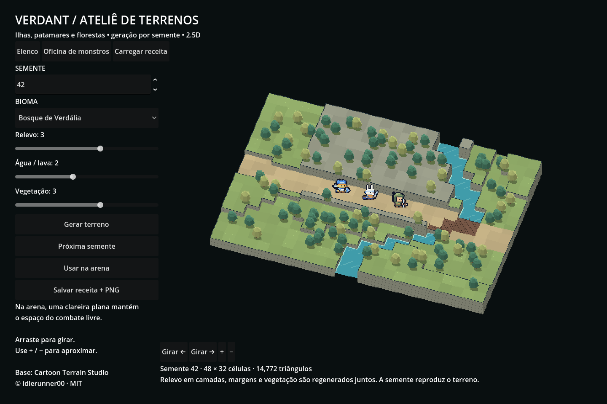
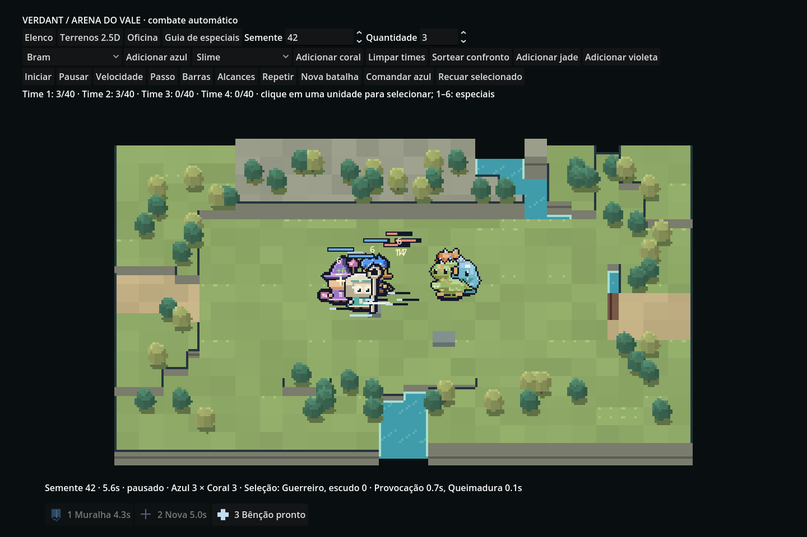

# Terrenos generativos 2.5D

O VERDANT agora gera uma malha de terreno por semente, com patamares, penhascos estratificados, rio/lago, pontes, trilhas e vegetação facetada. Câmera ortográfica e sprites Forge em nearest mantêm a leitura 2.5D. A cena usa Godot **4.5.2 .NET / Compatibility**.

Abra **Terrenos 2.5D** no elenco, na oficina de monstros ou na arena. Escolha semente, bioma e níveis de relevo/água/vegetação, depois pressione **Gerar terreno**. **Próxima semente** incrementa a semente sem depender do relógio. Arrastar, inclusive por toque, gira a câmera; os botões de giro/zoom oferecem a mesma função. **Usar na arena** transfere a receita para o cenário de combate.



## O que foi reaproveitado da base

Fonte: [Cartoon Terrain Studio](https://github.com/idlerunner00/cartoon-terrain-studio), commit `7aa76ad58d4a31c4a9441f5718e8c3a31d6349a1`, MIT, © 2026 idlerunner00.

- `Elevation.cs` e `Scalar.cs` foram incorporados sem alterações. O gerador chama o ruído fractal, o value noise e o hash espacial reais do projeto para relevo, curso d'água e vegetação.
- Um adaptador numérico mínimo conserva `floor`, multiplicação de inteiros e conversão ECMAScript de 32 bits, sem puxar o runtime JS completo.
- A construção usa blocos 2×2, seguindo o princípio de patamares legíveis de `TerrainTerrace.cs`. A composição de arena e o renderer são adaptações novas.
- O upstream usa Godot 4.7.2/Forward+. Não foram importados o editor completo, o compositor de mapas, mundo infinito, erosão, cachoeiras, shaders comic complexos nem ferramentas de pintura. Não se trata do Studio inteiro embutido.
- Licença, referência e avisos estão em [third_party/cartoon-terrain-studio](../third_party/cartoon-terrain-studio/). Os presets incluem os avisos para exportações futuras.

Quatro vetores de referência foram calculados compilando o `Elevation.cs` e o runtime JS do repositório original em um projeto separado. O adaptador produziu exatamente os mesmos doubles; log em [upstream-vectors.log](terrain/upstream-vectors.log). A UI também mostra o crédito da base.

## Dados e visual

`terrain/Sim` é C# puro, compilado em `Verdant.Core` e pelo PixelPreview. `TerrainRecipe` contém semente, tema, relevo, água, floresta e indicador de arena. O mapa tem 48×32 células; cada célula contém nível, material e tipo de árvore. Relevo é quantizado, com uma formação montanhosa de posição dependente da semente. Uma trilha contínua atravessa o mapa; em água, vira ponte.

Temas: bosque, pântano, cinzas/lava e gelo. Os temas trocam paletas; a geometria permanece igual para a mesma semente e parâmetros, permitindo comparar estilos. Relevo/água/vegetação em zero eliminam o respectivo componente. Vegetação não usa modelos/texturas externos.

`terrain/UI/TerrainStage` combina terreno, penhascos, árvores e pontes em uma malha, mais a superfície de água. A malha só é reconstruída ao gerar. Água/lava recebe ondulação visual no shader; esse tempo de apresentação não entra na geração nem no combate. Contornos e estratos estão na geometria, sem depender do pós-processamento Forward+ da origem.

A prévia usa SubViewport 480×270 ampliado 2× com nearest. A arena usa 320×150 ampliado 4× e os sprites permanecem em escala inteira 3×. Não há rasterização de sprites por frame. A prévia de três heróis usa os atlases existentes como billboards 3D. Esta é uma interface desktop com arrasto por toque; não é a UI mobile completa da run.

## Integração na arena

O miolo do mapa de arena é uma clareira plana, livre de vegetação e água. O relevo fica nas bordas. A simulação permanece no plano original: rios e penhascos decorativos não acrescentam obstáculos, custo de movimento, dano, cobertura ou novos caminhos. Os dois obstáculos já existentes são apresentados como blocos 3D com as mesmas dimensões físicas.

Unidades, projéteis, eventos, áreas e seleção compartilham a projeção da câmera. Clique de movimento usa a projeção inversa do raio contra o plano de combate. Não foram alterados `battle/Sim`, receitas de combate, habilidades ou pixels Forge. Como antes, unidades agrupadas podem sobrepor sprites. Na arena os atores são desenhados sobre o viewport; a clareira evita a necessidade de oclusão entre atores e vegetação decorativa.



## Receita, imagem e reprodução

**Salvar receita + PNG** grava `user://terrain/recipe.json` e `terrain.png`; a receita usa JSON com versão 1, escrita temporária e renomeação. **Carregar receita** valida a versão e os valores antes de regenerar. A interface aceita sementes de 1 a 999999; o núcleo aceita ulong e dobra os bits para o campo original de 32 bits. Sementes de 64 bits diferentes podem coincidir após essa dobra. O JSON não é intercambiável com o documento completo do Cartoon Terrain Studio.

A imagem exportada corresponde à câmera atual; orientação/zoom não fazem parte da receita, que reproduz o mapa. Não há save de campanha nem alteração do formato de receitas dos monstros.

## Executar e validar

```sh
dotnet run --project tools/PixelPreview -- terrain-check
dotnet run --project tools/PixelPreview -- pixel-verify docs/portability/atlas-sha256.json
dotnet run --project tools/PixelPreview -- battle-trace /tmp/terrain-events.json
./scripts/run.sh res://terrain/UI/TerrainWorkshop.tscn
DISPLAY=:99 ./scripts/run.sh --audio-driver Dummy res://terrain/UI/TerrainWorkshop.tscn -- --terrain-ui-test
DISPLAY=:99 ./scripts/run.sh --audio-driver Dummy res://terrain/UI/TerrainWorkshop.tscn -- --terrain-capture
DISPLAY=:99 ./scripts/run.sh --audio-driver Dummy res://battle/Arena.tscn -- --battle-ui-test
DISPLAY=:99 ./scripts/run.sh --audio-driver Dummy res://battle/Arena.tscn -- --battle-benchmark
```

Resultados e limites da execução estão em [terrain/RESULTADOS.md](terrain/RESULTADOS.md). As capturas são do Godot real. Android, navegador e GPU de celular não foram executados; não se assume que o benchmark desktop comprova desempenho mobile. Os ZIPs anteriores não contêm este terreno; execute o código pelo Godot.
