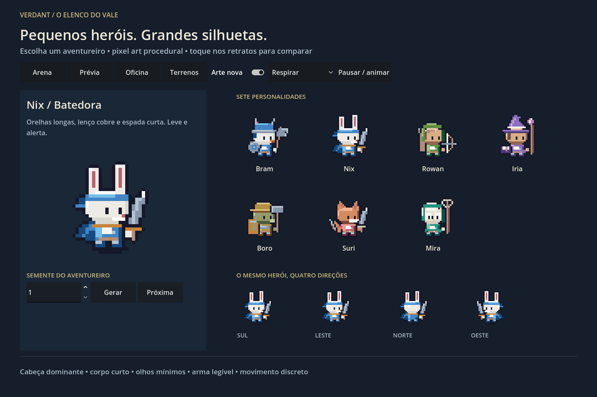
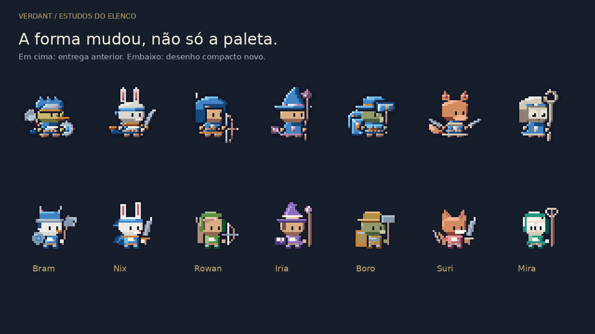

# Redesenho compacto — resposta à revisão visual

A entrega M1 foi rejeitada pelo autor por ainda parecer distante das referências. Esta revisão muda **o desenho dos personagens**: cabeça 13×10, corpo 8×5, pés de dois pixels, olhos mínimos, contorno externo de um pixel, equipamentos em camadas e cores próprias dos sete heróis. O corpo sem acessórios tem aproximadamente 59% de cabeça em altura (10 de 17 pixels, incluindo pés). A célula/origem continuam 32×32/(16,29).




## Alterações visuais

- Bram agora tem cabeça clara, elmo azul/metal, machado separado e escudo redondo; o verde/amarelo da pelagem anterior foi substituído para se aproximar da leitura clara da referência.
- Nix tem face simples, orelhas longas, corpo curto, capa em poucos pixels e espada inclinada; os pés usam azul/brilho em vez de blocos marrons.
- Rowan conserva o capuz verde, agora com cabelo lateral e arco separado da cabeça.
- Iria recupera o violeta como identidade, chapéu menor e cristal distinto do cajado.
- Boro usa bronze/oliva, carapaça e escudo lateral; martelo e rosto deixam de formar uma massa só.
- Suri conserva o laranja/vinho, orelhas e cauda; as duas lâminas continuam distintas.
- Mira usa rosto claro, moldura jade e aro vazio no báculo.

O passe de contorno anterior engrossava também os contornos de peças já compostas. O renderer novo só expande o preenchimento; isso elimina a borda dupla de arma/escudo e abre espaço na célula. A luz é explícita por planos, evitando as faixas excessivas da primeira tentativa de material/luz.

Há respiração, piscar, orelhas/capa com atraso, passada curta, antecipação/golpe/recuperação, recuo e queda lateral na morte. A morte usa seis quadros no tempo que a arena já tinha, com pose deitada e equipamento no chão antes de desaparecer. As quatro vistas são geradas pelo mesmo código; norte retira o rosto e constrói costas/capuz, oeste espelha a geometria. A arena conserva sua escolha lateral de direção, sem novas regras de movimento.

A galeria inicial mostra os sete heróis imediatamente, gera aventureiros por semente, troca ações e compara com o visual anterior. **Arte nova** na galeria e **Arte compacta** na arena controlam a comparação. A prévia antiga também usa o desenho novo por padrão, com atlas cacheado. Todos os personagens vêm de `Layer`/`Tone` e C#; nenhum sprite foi extraído das imagens/vídeo de referência.

## Validações executadas

Godot 4.5.2 .NET oficial, .NET 8, Linux, Compatibility/OpenGL, Mesa llvmpipe e display virtual. Saídas reais em [logs](logs/).

```text
CHIBI checks=131087 failures=0 max_colors=15 seeds=120 heroes=7 directions=4
PORTABLE_CORE no_godot=True atlas_hashes=5328 differences=0
SPECIAL checks=39 failures=0
BATTLE checks=1220 failures=0
BATTLE_EVENTS seeds=240 events=65548 differences=0
COMPACT_UI_PASS checks=41
PIXEL_UI_PASS checks=40
BATTLE_UI_PASS checks=19
```

A matriz cobre 7 heróis + 120 sementes, todos os clipes nas quatro direções: alfa binário, ≤32 cores declaradas (máximo observado 15), margem externa transparente, recorte, pixels órfãos no idle, repetição dos pixels, loops, movimento real de idle, queda/removibilidade e silhuetas únicas nos sete heróis e nas onze espécies existentes. A troca da cor de equipe conserva todos os demais materiais.

Não foram modificados `battle/Sim`, receitas de combate, stats ou efeitos de habilidades. Os 5.328 hashes do caminho antigo continuam iguais. Os eventos completos, resumidos por hash por semente, coincidem em 240 batalhas/65.548 eventos. Nenhuma validação antiga foi relaxada. O núcleo continua opt-in para a nova variante; a escolha padrão mudou somente nas cenas de apresentação.

UI no Godot: seleção dos sete heróis, comparação por toque simulado, semente/repetição, cache versus renderer e limites dos botões. A build Linux exportada passou **as mesmas 131.087 verificações e 41 testes da galeria**, abrindo na nova cena principal. Os argumentos antigos de teste continuam encaminhados à cena original.

Benchmark da arena: 42 combatentes, mediana **14,14 ms**, p95 **19,39 ms**, 360 quadros. É medição em software renderer/máquina compartilhada; **não garante 60 FPS estáveis**, e não é teste mobile. Nenhum sprite é rasterizado por frame na galeria, na arena ou na prévia compacta.

## Revisão visual

Foram abertas a comparação anterior/novo, as onze espécies, a galeria real, arena, tiras de ataque de Nix/Boro em 8× e a morte lateral de Nix. [Prancha em 1×/2×/3×](elenco.png) · [Espécies](especies.png) · [GIF da galeria](galeria.gif) · [GIF da arena](arena.gif). As primeiras armas verticais foram inclinadas e os pés simplificados após a primeira renderização; a linha dupla de contorno foi corrigida após a validação detectar a borda ocupada.

Ainda fraco: algumas espécies compartilham a mesma base de crânio; as costas são simples; o movimento lateral não é uma locomoção específica para cada uma das quatro direções. As poses de queda têm uma sustentação repetida no chão. A arena continua sobrepondo unidades quando se agrupam. O terreno e as nove famílias de monstros não foram redesenhados nesta revisão. Não há declaração de aprovação artística final: as pranchas mostram o resultado para avaliação do autor.

## Build e escopo

`downloads/Verdant-Windows.zip` foi atualizado; a abertura padrão é a galeria. ZIP/CRC, PE x86_64, runtime .NET e presença da cena no PCK verificados. **EXE Windows não executado neste Linux**. A build Linux equivalente foi exportada e executada. Há a mensagem de EditorSettings ao encerrar export headless e o aviso de VSync, preservados nos logs; os testes da build terminaram normalmente.

Android, web novo, GPU dedicada e toque físico não executados. A mudança atende ao redesenho visual imediato; não completa os marcos amplos de 45 espécies/20 classes/patentes, fluxos independentes por peça, bestas, heráldica, construções ou mundo. Não foram criadas regras de run, extração ou guerra.
