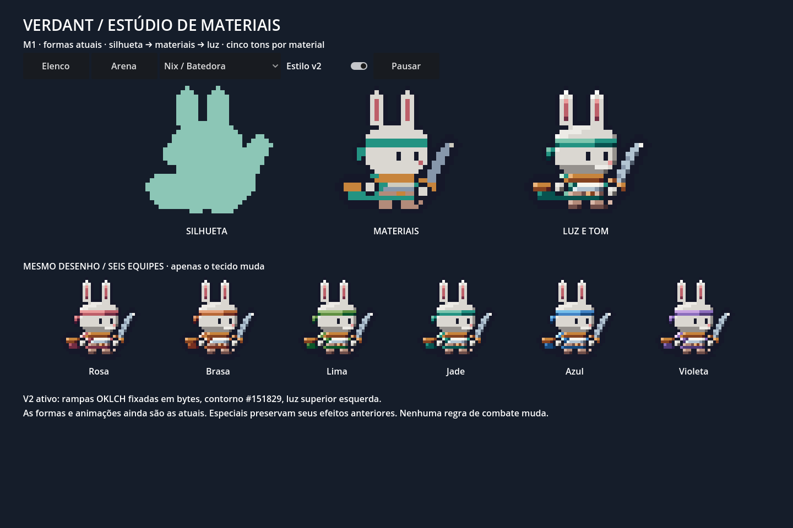
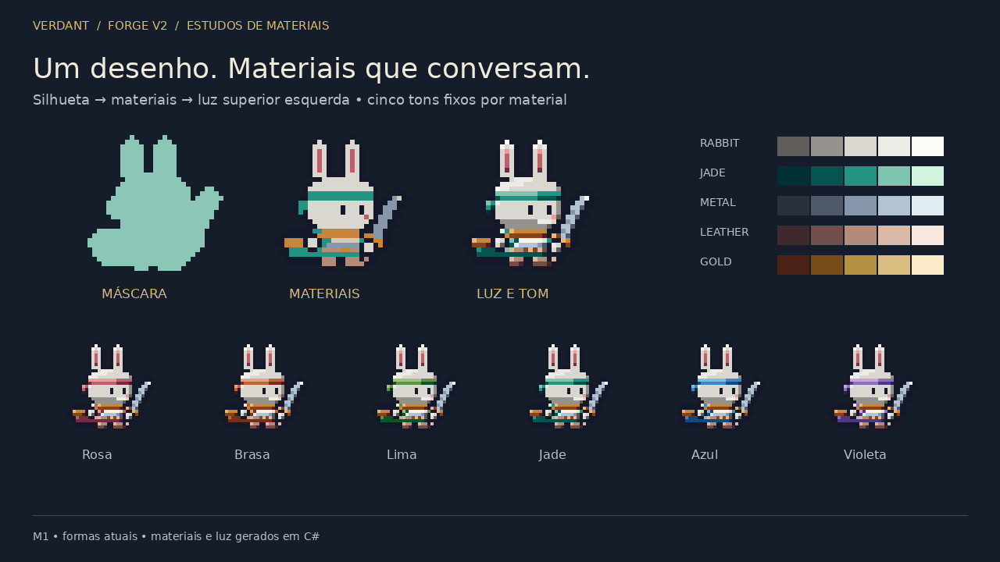
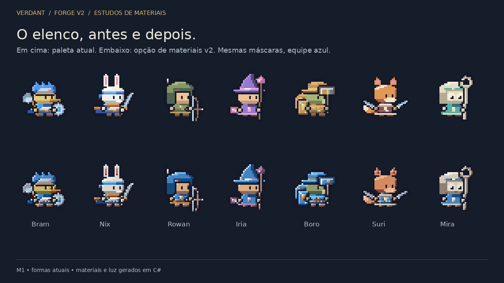

# Entrega M0/M1 — direção e materiais

**Implementado: M0 e M1.** Os demais marcos não estão concluídos. Esta entrega prepara e demonstra o sistema de cor/luz no elenco e nos monstros atuais; não anuncia espécies, classes ou animações novas.

Abra **Materiais v2** no elenco/oficina e ligue **Estilo v2**. A primeira linha mostra máscara/materiais/luz; a segunda compara seis equipes animadas. Na arena, a mesma opção troca os atlases durante a luta. O padrão anterior permanece desligado do novo pipeline. Windows: extraia todo `downloads/Verdant-Windows.zip`, abra `Verdant.exe` e use esses controles.





## Mudanças verificáveis

- 36 rampas fixas de cinco tons geradas offline em OKLCH: materiais, seis equipes, 11 pelagens e cinco elementos. Luz superior esquerda usa índices e vizinhança de material, sem cálculos perceptuais por frame.
- Reutilização de `Layer`, `Tone`, `ForgeFinish` e poses atuais. O limite v2 é 32 cores; máximo observado **31**. O legado conserva 16. A máscara não muda.
- Trocar a equipe altera somente pixels rotulados TEAM. Nenhuma decisão do combate consome RNG adicional. A troca de estilo na arena conserva o tick/eventos e restaura os pixels originais ao desligar.
- Atlas cacheado por receita, estilo e equipe; clipes atuais exportados em **49 PNGs de atlas + JSON**, com pivô, região, duração, paleta e tags. A nova página não rasteriza no `_Process`.
- Caixas úteis medidas no idle sem sombra: Bram **31×26**, Nix **29×29**, Rowan **27×29**, Iria **26×32**, Boro **29×25**, Suri **32×27**, Mira **24×31**. Incluem armas/contorno; ainda excedem o corpo compacto da referência. O quadro continua 32×32 e a origem (16,29).

## Saída dos testes executados

Linux, .NET 8, Godot **4.5.2 .NET** oficial, Compatibility/OpenGL, Xorg virtual e Mesa llvmpipe. Logs reais em [logs](logs/).

```text
STYLE_CONTRAST metric=rgb_squared minimum=1985 required=625 pairs=66
STYLE_V2 checks=44415 failures=0 max_colors=31 teams=6 inherited_border_frames=3035
PORTABLE_CORE no_godot=True atlas_hashes=5328 differences=0
checks=372861 falhas=0
SPECIAL checks=39 failures=0
BATTLE checks=1220 failures=0
BATTLE_EVENTS seeds=240 events=65548 differences=0
MATERIAL_UI_PASS checks=18
BATTLE_UI_PASS checks=19
PIXEL_UI_PASS checks=39
GODOT_STYLE_V2 checks=44415 failures=0
```

`check 200` inclui ForgeValidation, MonsterValidation e ícones. A matriz v2 cobre 31 receitas de herói, frente/costas e todos os movimentos, mais 135 combinações família/elemento/raridade nos movimentos completos. A distância de cores-base usa RGB inteiro ao quadrado; **não é contraste WCAG**, nem substitui o contorno/revisão visual. A prova de isolamento verifica os pixels não TEAM byte a byte. Determinismo foi executado localmente e a regeneração da tabela produz os mesmos bytes; não foram executadas novas verificações de v2 em outras arquiteturas.

Os 5.328 hashes RGBA legados permanecem iguais. `battle-trace` coincide com a referência anterior: **240 sementes/65.548 eventos, zero diferenças**. `battle/Sim`, tabelas de habilidades e balanceamento não mudaram. A matriz registra **3.035 amostras antigas tocando uma borda**, sem pixels recortados registrados. Os contornos/armas já atingiam os limites no v1; M1 mantém as máscaras. Não removemos nenhuma validação antiga para esconder isso. Margem completa para o redesenho pertence a M2.

UI: toque simulado no CheckButton real, seleção dos sete heróis, cache versus renderer, controles de 48 unidades lógicas e limites da janela. Na arena, teste de ligar/desligar e preservação do estado. Isso é validação desktop com eventos de toque, não execução em celular.

## Desempenho

Mesmo benchmark, mesma semente, 40 unidades iniciais/42 após invocação, 360 quadros por modo, executados em sequência:

| Modo | Mediana | p95 |
|---|---:|---:|
| V1 | 14,06 ms | 19,84 ms |
| V2 | 15,11 ms | 21,17 ms |

Uma amostra por modo em máquina compartilhada/software renderer. A diferença observada não isola custo de GPU nem garante causalidade; a rasterização acontece antes da medição. **Não atingiu 60 FPS estáveis no p95**. Geração CLI da categoria M1 (sete heróis, nove monstros, seis equipes, provas e 49 atlas): **349,7 ms**, inclui codificação PNG e I/O. Mais categorias não foram medidas porque ainda não foram implementadas. Tamanho das texturas por receita permanece igual; equipes diferentes exigem texturas distintas.

## Revisão visual e pontos fracos

Foram abertas a folha de materiais, comparação dos sete heróis, nove monstros, leitura 2× e captura real da arena/estúdio. A leitura 1×/2×/3× em fundos claro/escuro está em [1×](m1-leitura-1x.png), [2×](m1-leitura-2x.png), [3×](m1-leitura-3x.png); a inspeção adicional das escalas está registrada junto às provas. [Arena PNG](m1-arena.png) · [GIF amostrado em 48 quadros](m1-arena.gif).

A primeira rampa deixava o coelho cinza; foi corrigida com luminosidades próprias por material. A máscara de prova inicialmente conservava os olhos vazados; agora todo pixel opaco usa uma cor. O acento de Iria/Mira foi preservado em rampas próprias. Os testes de equipe motivaram uma base de tecido mais escura para separar equipe lima da pele verde.

Ainda fraco: slime e besta têm massa semelhante; o rosto de Boro compete com martelo/escudo; arco de Rowan e cajado de Mira ocupam muito da célula. Usar um só time nos sete heróis reduz diferenças de vestimenta: o chapéu de Iria, por exemplo, assume a cor da equipe. Não se perde sua forma, mas a personalidade depende mais do acento/pose. A luz de vizinhança pode produzir faixas finas em cruzamentos de peças; M2 deve separar melhor planos e materiais, em vez de acrescentar ruído. Na arena os sprites próximos continuam sobrepostos. O terreno 3D ainda tem outra linguagem de acabamento.

## Builds e o que não foi executado

- Windows x86_64 atualizado, **190 arquivos**, runtime incluído. PE x64, runtime, cena do estúdio no PCK e CRC de todos os arquivos do ZIP verificados. **EXE não executado**: não há Windows/Wine neste ambiente.
- Build Linux equivalente exportada e **executada**: 44.415 verificações v2, zero falhas; 18 testes de UI na build exportada. Usada como validação adicional, sem substituir o ZIP Linux histórico nesta entrega.
- O exportador retornou código 0 e gerou os pacotes. Há uma mensagem `ERROR` de `_EDITOR_GET`/EditorSettings ao encerrar o Godot headless, preservada nos logs; o executável Linux correspondente abriu e passou os testes. O driver também avisa que não pode alternar VSync.
- Android, web v2, dispositivo físico, GPU dedicada e Windows real não executados. O estudo/prova web anterior não valida este pipeline novo.
- Não implementados M2–M8: fluxos por peça, ampliação para 45 espécies/20 classes, patentes, quatro direções/mortes de herói, dez bestas, heráldica, construções/props/flora, terreno pintado/assentamentos/mapa, estúdio completo e exportação de dados de mundo. Não houve alteração da run ou guerra.

Próximo marco: **M2**, primeiro com as 11 espécies existentes. Redesenhar anatomia/equipamentos para caber com margem, decompor em camadas por fluxo nomeado e provar a independência antes de ampliar o catálogo. M3–M5 devem usar essa base, com revisão visual por categoria.
