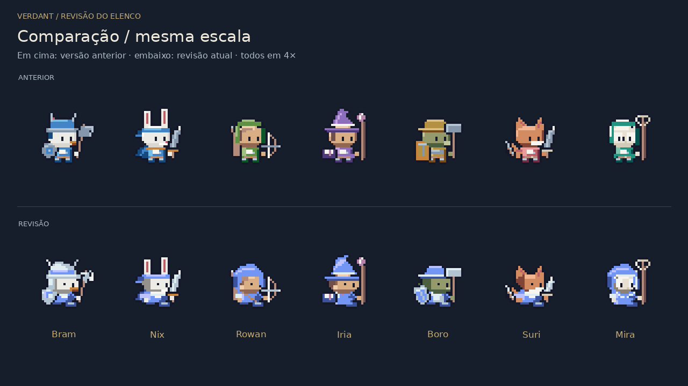

# Revisão do elenco pela referência em vídeo

Esta revisão corrige a versão compacta rejeitada pelo autor. O alvo é a construção visual observada no vídeo: postura em três quartos, cabeça integrada à roupa, corpo baixo, equipamentos legíveis e uma paleta de equipe comum. As imagens abaixo permitem comparar o resultado; não são uma declaração de reprodução exata ou de aprovação artística.



[Prancha em 1×/2×/3×, fundos claro e escuro](elenco.png) · [Galeria real no Godot](galeria.png) · [Animação da galeria](galeria.gif) · [Onze espécies](especies.png)

## O que mudou

- **Bram:** coroa e aba do elmo formam volume, a proteção lateral invade a borda da face, o escudo tem perspectiva e o machado usa lâmina em cunha com contrapeso.
- **Nix:** rosto em três quartos com sombra lateral, corpo menos vertical, pé dianteiro dominante e lenço integrado à silhueta. A espada e a mão avançam junto do impacto.
- **Rowan:** capuz arredondado envolve o rosto; a alça diagonal substitui a faixa branca genérica. O arco mostra puxada, liberação e recuperação.
- **Iria:** chapéu com coroa inclinada e aba sobreposta; painel claro lateral diferencia a roupa da dos combatentes; o grimório sobe na preparação.
- **Boro:** cabeça larga com focinho próprio, aba ampla e escudo afunilado. O martelo continua retangular para contrastar com o machado.
- **Suri:** mandíbula em cunha, focinho claro avançado e roupa curta. Cauda, orelhas e duas adagas encurtadas preservam sua identificação.
- **Mira:** face em máscara, capuz envolvente e gola em V. O aro do báculo continua vazado, e a mão livre sobe no gesto de bênção.

A revisão elimina o cinto horizontal comum e amplia a massa do tronco. A cabeça-base tem nove linhas, com perfis por espécie; a célula continua **32×32**, origem **(16,29)**. Elmo, orelhas e chapéus completam a altura. Os sete heróis usam **Equipe azul** por padrão, com uma nova rampa `Cornflower` calculada offline em OKLCH. **Cores do herói** é uma opção da galeria, ao lado da comparação com o legado.

As animações preservam os tempos existentes. O ataque avança dois pixels no impacto, comprime/recupera o corpo e atrasa a capa. O idle mantém respiração e piscar discretos. Todos os quadros continuam gerados por C# no Forge e guardados em atlas; a apresentação apenas seleciona texturas. Não foram copiadas imagens do vídeo para o jogo.

## Revisão visual e limites

Foram abertas a comparação entre versões, a prancha em escalas pequenas e fundos claro/escuro, as ampliações de idle/impacto e a galeria real do Godot. As tiras de ataque em 8× dos sete heróis foram abertas, e os GIFs estão nesta pasta, um por herói. Os 14 GIFs de sprites tiveram duração conferida: 750 ms para ataque e 4.000 ms para idle, distribuindo o arredondamento do formato GIF. Foram inspecionados também o rosto corrigido de Mira em 8× e a captura da arena; a sobreposição de unidades na arena ainda reduz sua leitura. A segunda passagem corrigiu base da roupa, sombras laterais, golas/alças e distinção entre machado e martelo.

Ainda fraco: norte é uma vista simples, oeste espelha o desenho e as quatro vistas usam a mesma lógica lateral de locomoção. A morte conserva poses de sustentação repetidas. Algumas espécies ainda compartilham o mesmo crânio-base. A galeria mostra o equipamento isolado com mais clareza que uma aglomeração de unidades na arena. Essa revisão não redesenha monstros ou terreno nem conclui a expansão M2–M8 de classes, espécies, heráldica e mundo.

## Validações executadas

Godot **4.5.2 .NET**, SDK **8.0.408**, Linux, Compatibility/OpenGL, display virtual e Mesa llvmpipe. [Logs completos](logs/).

```text
CHIBI checks=131095 failures=0 max_colors=15 seeds=120 heroes=7 directions=4
checks=372861 falhas=0
PORTABLE_CORE no_godot=True atlas_hashes=5328 differences=0
BATTLE checks=1220 failures=0
SPECIAL checks=39 failures=0
BATTLE_TRACE seeds=240 events=65548
BATTLE_EVENTS differences=0
COMPACT_UI_PASS checks=62
BATTLE_UI_PASS checks=19
```

A matriz compacta cobre sete heróis e 120 receitas geradas, clipes nas quatro vistas, alfa binário, margem, recorte, determinismo, loop, morte/removibilidade, órfãos no idle e isolamento da cor de equipe. O teto dessa variante foi reduzido de 32 para **16 cores**, com máximo real de 15. O teste também cobre o espelhamento leste/oeste e impede a sobreposição de um terceiro olho na coruja. `check 200` inclui Forge, monstros e ícones; os **5.328 hashes legados** permanecem iguais. As **240 sementes/65.548 eventos** de batalha coincidem com o baseline. Simulação, balanceamento e efeitos de especiais não foram alterados.

A UI real verifica seleção, geração repetível, alternância de paleta e legado, equivalência entre cache e renderer, escalas inteiras e limites dos controles. A alternância usa eventos de toque simulados; não houve teste em dispositivo físico.

## Desempenho e executáveis

Baseline real desta sessão, antes da revisão: **42 unidades**, 360 quadros, mediana **15,49 ms**, p95 **23,05 ms**. O resultado não garante 60 FPS estáveis e usa renderização por software em uma máquina compartilhada.

Depois da revisão: **42 unidades**, 360 quadros, mediana **14,63 ms**, p95 **21,32 ms**. Esta variação em software renderer não permite prometer ganho em hardware real nem 60 FPS estáveis.

Os dois pacotes foram exportados com runtime .NET incluído e estão em `downloads/Verdant-Windows.zip` e `downloads/Verdant-Linux.zip`. O ZIP/CRC, a arquitetura dos executáveis, os arquivos de runtime e a cena principal dentro do PCK foram conferidos. A build **Linux exportada foi executada**: 131.095 verificações de arte, 62 testes da galeria e 19 da arena, todos sem falhas, sem depender de `DOTNET_ROOT` externo. **O EXE Windows não foi executado** neste ambiente Linux. Android, web desta revisão e dispositivos físicos não foram executados.

O export headless encerra com a mensagem de `EditorSettings::_EDITOR_GET` já presente na versão anterior, embora retorne código 0 e produza pacotes válidos; os logs completos preservam a mensagem. A execução gráfica usa display virtual sem VSync. Essas limitações não foram ocultadas como testes em hardware real.

## Reproduzir

```sh
dotnet run --project tools/PixelPreview -- chibi docs/arte/revisao-referencia/atlas
python3 scripts/reference-review.py
dotnet run --project tools/PixelPreview -- chibi-check
dotnet run --project tools/PixelPreview -- check 200
dotnet run --project tools/PixelPreview -- pixel-verify docs/arte/estilo-v2/antes/atlas-sha256.json
dotnet run --project tools/PixelPreview -- battle
dotnet run --project tools/PixelPreview -- special-check
DISPLAY=:99 ./scripts/run.sh --audio-driver Dummy -- --compact-ui-test
DISPLAY=:99 ./scripts/run.sh --audio-driver Dummy battle/Arena.tscn -- --battle-ui-test
```
